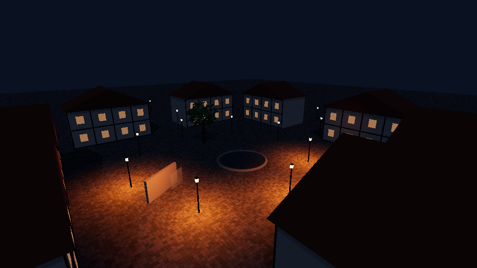
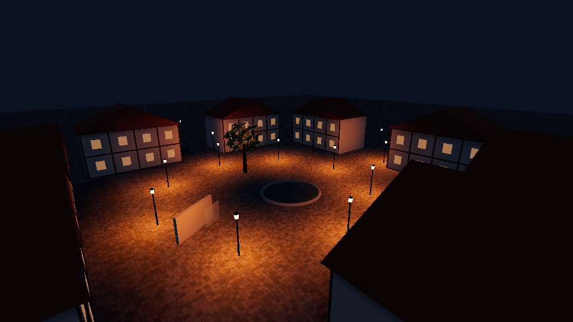
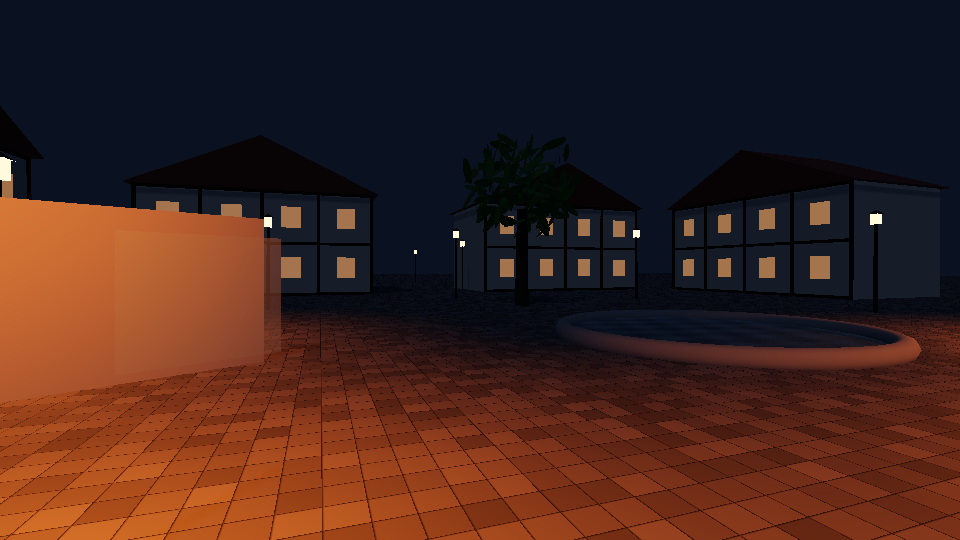
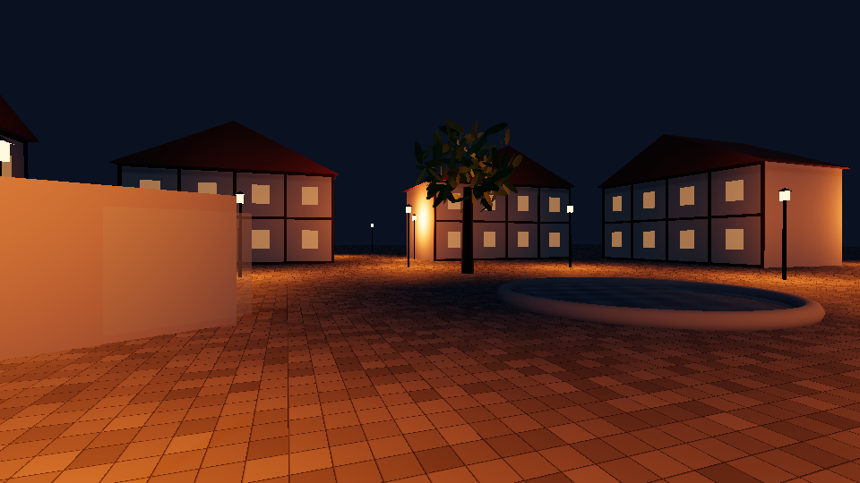
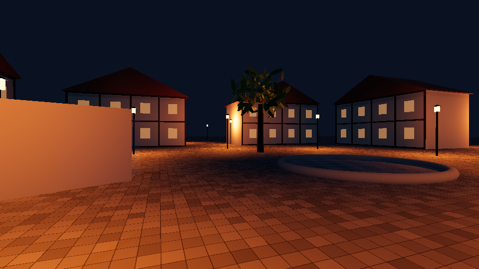
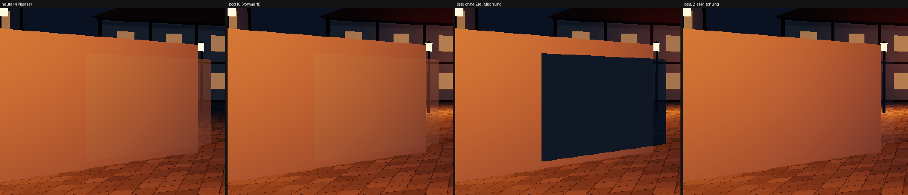
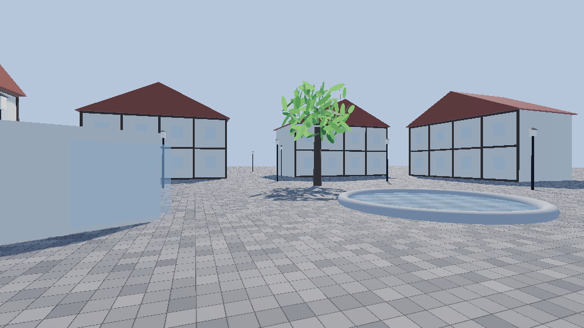
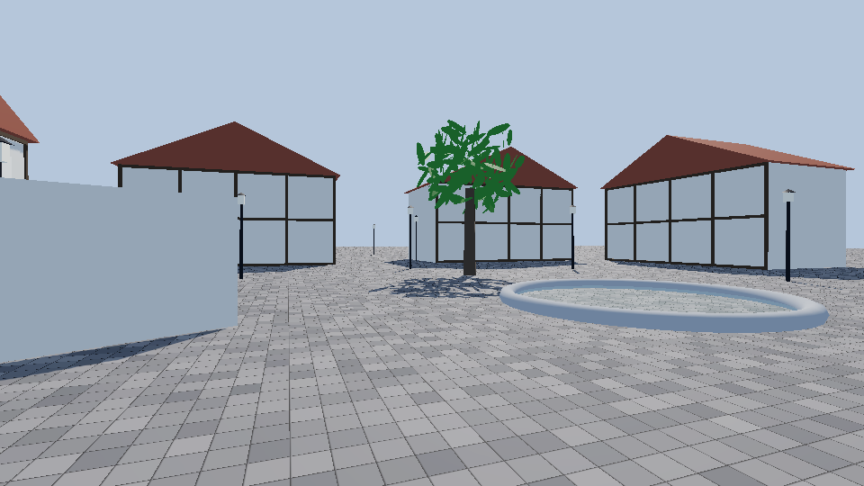
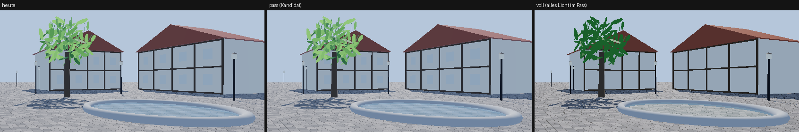

# SAMEN-BEFUND LICHTWEG (w28-samen-lichtweg, 12.11.2026) — Zwischenstand, kein Schnitt im Kern

Stand des Baums: `f46b9e81` (V18.546.264). Alles hier ist Befund + Wegwerf-Spike in `samen/lichtweg/`; keine Datei außerhalb ist berührt.

**Wie gemessen wurde — und was das NICHT trägt**

- **Echte Welt** (`mess-welt.cjs`): der echte Boot `index.html?holz=voll` bis zum ersten Weltbild (`_weltbildDa`), headless, swiftshader.
  Ein Haken an `GPUDevice.createShaderModule` zählt den ECHTEN WGSL-Text und reicht dem Treiber eine Attrappe mit denselben Ausgängen
  (swiftshader übersetzt eine Pipeline der Welt in 42–292 s, Lehre 26). Echt sind: Zahl der Programme, Text, Knoten, Knoten-Bau
  (r184-JS). **Nicht** gemessen: Übersetzungs-Zeit einer Karte, Bild-Zeit, die Ankunft in Sekunden. Je Fall ein Patch hinter
  `stamm/dirigent-takt.js` in der ausgelieferten Kopie (kein Datei-Schnitt). 10 Fälle, 2–4 Läufe.
- **Spike-Szene** (`platz.html` · `platz.js` · `platz.cjs`): ein Dorf-Platz, 14 Laternen (`LICHT_GESETZ.laterne`), r184 aus `vendor/`,
  echte Shader. Das Pool-Gesetz ist aus `stoff-material.js:2414–2500` abgeschrieben, die Wahl aus `dirigent-kern.js:1744–1753`.
  Von dort kommen die BILDER und die Zahl der beleuchtenden Lichter. **Jede ms-Zahl ist swiftshader (CPU-Raster) — keine Karten-Zeit.**
- Nicht gelesen: der Zweig `koordination` (der Abruf lief ins Zeitlimit) — die beiden Befunde vom 12.11. kenne ich nur aus dem Auftrag.
  Kein Bild der ECHTEN Welt bei Nacht: mit echten Shadern standen unter swiftshader nach 7 min 8 Programme.

## 1 · FAKTEN (Quelle mit Datei:Zeile, Zahl aus `mess/welt-*.json`)

1. **Der Pool:** `LICHT_POOL = { plaetze: 4, umkreisM: 48, wahlS: 0.25, wahlM: 1, blendeS: 0.5 }` (`stamm/stoff-material.js:3754`).
2. Er hängt als Summand am Leuchten JEDES beleuchteten Stoffs: `knoten[licht] = em.add(this._lichtPoolTerm(…))` (`stoff-material.js:2064`,
   `_leuchtStoff` :2037); nur Glut/Leucht-Stoffe lesen ihn nicht (`"quelle"`, :2042–2044).
3. Die Rechnung: `Te.Loop(plaetze)` (:2421) über `_lichtPlatz` (:2450) — je Platz 4 Select-Ketten zu N−1 Gliedern (`_jePlatz`, :2439;
   bei 4 Plätzen 48 Selects je Fragment, bei 16 sind es 960: die Kette wächst N²), 1 Matrix × Vektor, Abfall mit `pow`, Lambert + GGX
   (`_punktLichtBrdf`, :2482). Das Ergebnis wählt `select(bedingung, beitrag, 0)` (:2474) NACH der Rechnung: jeder Platz kostet jedes
   beleuchtete Fragment die ganze BRDF, auch leer, auch am Mittag (WGSL-Semantik; ob ein Treiber kürzt, ist ungemessen).
4. Die Wahl (`_leuchtTakt`, `stamm/dirigent-kern.js:1601`): alle 0,25 s oder 1 m die 4 Quellen mit dem kleinsten Rang (:1634–1636); Rang =
   Reichweiten-Kugel außerhalb des Sichtkegels + 10⁹, sonst Abstand zur Kugel × 10³ + Abstand (:1752). Wer waagrecht weiter als 48 m
   vom Auge steht, steht nicht zur Wahl (:1760). EIN Platz trägt einen Würfel-Schatten, 256 px (`_lichtWurf`, `bild-schatten.js:399`, :1684).
5. Die Laterne: `{ kelvin: 1900, staerke: 19, reichweiteM: 12, abfall: 2, kernM: 0.1, hoeheM: 3.6 }` (`fachwerk-core.js:5350`), Soll-Abstand 9 m.
   Bei 9 m Abstand und 4 Plätzen trägt eine Gasse höchstens 4 Lichtkreise um das Auge; der Rest glüht nur (`lichtGlut`, :2060).
6. **Vor dem ersten Weltbild** (`holz=voll`, 4 Läufe): **59 Fragment-Module, 2,16 MB** · 55 Vertex-Module, 0,36 MB · 52 Knoten-Bauten,
   116 307 Knoten, Knoten-Bau 1553–1745 ms (JS dieses Containers).
7. **Wer trägt den Lichtkern:** 20 der Bauten tragen den Pool (18 Standard, 2 Physical) — Ø 76,5 KB Fragment-Text, 4 053 Knoten,
   zusammen 1,49 MB = 68 % des Fragment-Texts. **Wer ihn nicht braucht:** 36 Bauten — 12 Schatten-Werfer (`ShadowMaterial`, Σ 112 KB),
   4 Quellen-Stoffe (Σ 180 KB), 6 Basic-Stoffe ohne r184-Licht, 14 Pässe und Tafeln (Spiegel 71 KB, Kontakt 32 KB, TRAA 23 KB, Atmosphäre, PMREM).
8. **Die Glieder je Pool-Programm** (Abtragung, je Glied EIN Boot ohne es; Ø Fragment-KB · Ø Knoten):

   | Glied | Quelle | − KB je Programm | − Knoten | Fragment-Text gesamt |
   |---|---|---|---|---|
   | Kaskaden (3, Empfang, je 5 Abgriffe) | `dirigent-ankunft.js:406`, `bild-schatten.js:1041/1051` | 19,8 | 1 123 | 2,16 → 1,65 MB (samt der 12 Werfer) |
   | Umgebung (EIN Himmel, PMREM) | `bild-himmel.js:694–715`, `bild-sicht.js:660` | 8,5 | 787 | 2,16 → 1,90 MB |
   | Licht-Pool (4 Plätze) | `stoff-material.js:2414` | 8,8 | 386 | 2,16 → 1,99 MB |
   | Nässe | `_naesseImStoff`, `stoff-material.js:2078` | 4,0 | 211 | 2,16 → 2,06 MB |
   | Luft (`scene.fogNode`, 8 Proben im Vertex) | `bild-himmel.js:2342`, `dirigent-ankunft.js:1926` | 2,3 | 327 | 2,16 → 2,10 MB (+ Vertex 0,36 → 0,30) |
   | alle fünf | | **37,9 (50 %)** | **2 264 (56 %)** | **2,16 → 1,17 MB, 59 → 44 Module** |

9. Die Decke ohne Lichtkern: Knoten-Bau 796–1079 ms statt 1553–1745 (−49 %), 56 307 statt 116 307 Knoten. Das deckt den Befund vom
   12.11. (1,86 → 1,05 MB, 40 → 31). **Aber:** von den 15 Modulen weniger sind 13 die Schatten-WERFER (ohne Kaskaden: 59 → 46) — sie fallen nur, wenn die
   Schatten-Karte fällt, nicht wenn das Licht den Ort wechselt. Empfänger-seitig trägt der Lichtkern 20 × 37,9 KB = **0,74 MB (34 %)**
   und 45 280 Knoten (39 %).
10. **Zwischen-Ziele heute:** EIN Szenen-Pass (`bild-kosten.js:2045`) in der Skala 0,75 (:3663), MRT mit zwei Zielen — `output`
    (rg11b10ufloat) und `glanz` (r8, 1,17 MB bei 1080p) (:2056) —, Tiefe als Textur (:2097). Die Normale gibt es nicht als Ziel: der
    Spiegel-Pass rechnet sie aus der Tiefe (`bild-sicht.js:840`), Kontakt-Schatten und Rückstrahl lesen dieselbe Tiefe
    (`bild-schatten.js:1428`, :114). Albedo, Rauheit, Metall: kein Ziel. Kein MSAA — die Kante glättet TRAA (`dirigent-ankunft.js:149–153`).
11. **Kein nachgelagertes Licht können:** alles Durchsichtige — Glas (`studio-stoff.js:242`), Rauch (`stoff-material.js:2074`), die Geister
    der Vorschau (`siedlung-bauten.js:1181`) — r184
    mischt nur `output`, jedes weitere Ziel überschreibt (`bild-kosten.js:2054`); das Wasser ist ein `MeshBasicNodeMaterial` mit eigenem
    Licht (`bild-sicht.js:1557–1560`) und trägt den Pool schon heute nicht; das Haar rechnet Kajiya-Kay (`studio-stoff.js:27–43`), ein
    GGX-Pass träfe es falsch. Laub mit ausgeschnittenem Alpha KANN es (die Alpha lebt in `colorNode.a`, Lehre 26); der Himmels-Ersatz
    des Augen-Lichts braucht die Himmels-Sicht je Fläche (`aHimmel`, :2454) als Kanal. „EIN Szene-Pass" ist Gesetz (`bild-kosten.js:2062`).

## 2 · URTEIL: die EINE begrenzende Entscheidung

**„Das Licht der Quellen ist ein Term im Programm jedes Stoffs" begrenzt am stärksten das NACHT-BILD**: jeder Platz kostet Text in 20
Programmen und die ganze BRDF in jedem beleuchteten Fragment — darum sind es 4, und darum beleuchten von 14 Laternen 10 nichts.
Für die ANKUNFT ist dieselbe Entscheidung nur ein Achtel des Problems: der Pool trägt 0,17 von 2,16 MB (8 %); die Hälfte jedes
Standard-Programms sind Kaskaden (19,8 KB) und Umgebung (8,5 KB), nicht die Laternen. Für die BILD-ZEIT gibt es hier keine Zahl.

## 3 · SPIKE — drei Fälle (+ zwei Gegenproben)

**(a) heute** 4 Plätze im Stoff · **(b) pool16** 16 Plätze im Stoff (`plaetze: 16`, sonst nichts) · **(c) pass** der Kandidat: kein Pool
im Stoff; der Szenen-Pass schreibt zwei Ziele mehr (Normale + Metall, Albedo + Rauheit, je rgba8), EIN Licht-Programm (7,4 KB,
286 Knoten) rechnet 16 Quellen einmal je Pixel und addiert vor der Tonkurve. Gegenproben: **pass-loch** (ohne Ziel-Mischung) und
**voll** (ALLES Licht im Pass — Sonne, Schatten, Umgebung, Quellen; die Stoffe schreiben nur den G-Puffer).

### 3.1 Die echte Welt, vor dem ersten Weltbild (Attrappen-Shader; Median, ms = kleinster von n Läufen)

| Fall | Fragment-Module · MB | Vertex · MB | Knoten Σ | Knoten-Bau ms (alle Läufe) | Ø Pool-Programm KB |
|---|---|---|---|---|---|
| (a) heute | 59 · 2,16 | 55 · 0,36 | 116 307 | 1553 (1623 · 1745 · 1697 · 1553) | 76,5 |
| (b) pool16 | 59 · **2,37** | 55 · 0,38 | 122 174 | 1609 (1786 · 3069 · 1873 · 1609) | 88,2 |
| pool8 | 59 · 2,22 | 55 · 0,36 | 118 545 | 1504 (1883 · 1504) | 79,7 |
| Pool raus, kein G-Puffer | 59 · 1,99 | 55 · 0,34 | 108 579 | 1425 (1425 · 1662 · 1632 · 1548) | 67,7 |
| (c) Kandidat: Pool raus + G-Puffer | 59 · **2,00** (+ 1 Licht-Programm, 7,4 KB aus der Spike-Szene) | 55 · 0,34 | 108 710 | 1708 (1753 · 1708 · 1740) | 67,9 |
| Decke (Lichtkern raus, auch die Werfer) | 44 · 1,17 | 39 · 0,19 | 56 307 | 796 (911 · 802 · 1079 · 796) | 38,6 |

Der Kandidat spart 0,16 MB Fragment-Text (−7 %) und 7 597 Knoten (−7 %); im Knoten-Bau liegt er IM Rauschen von heute, kein Gewinn
messbar. Unter swiftshader kam sein Weltbild 12 s SPÄTER (47,5 · 49,3 · 50,3 s gegen 35,4–40,1 s): das CPU-Raster zahlt zwei Ziele
mehr je Bild. Ob eine Karte das spürt, ist offen (siehe 5).

### 3.2 Die Spike-Szene (960 × 540, echte Shader; Bild-ms = swiftshader, CPU-Raster, keine Karten-Zeit)

| Fall | Programme F/V | Text KB | Knoten | Quellen mit Platz (Auge · oben) | Laternen im Bild, die Boden beleuchten (Auge · oben) | Bild-ms Nacht · Mittag |
|---|---|---|---|---|---|---|
| (a) heute | 20 / 10 | 283 | 8 746 | 4 · 4 | **0 von 7 · 4 von 12** | 182 · 139 |
| (b) pool16 | 20 / 10 | 374 | 11 518 | 13 · 9 | 6 von 7 · 9 von 12 | **1029 · 1041** |
| (c) pass | 20 / 10 | 250 | 7 299 | 13 · 9 | 6 von 7 · 9 von 12 | 254 · 244 |
| voll | 20 / 11 | 121 | 3 914 | 13 · 9 | 6 von 7 · 9 von 12 | 250 · 241 |

„Beleuchtet" = acht Boden-Punkte im Ring 1,6 m um den Fuß, frei sichtbar (Strahl-Probe), im Bild ≥ 30 Stufen heller als im selben
Bild mit Quellen-Stärke 0 (gemessen 60–118 mit Platz, 0–2 ohne). Am Auge liegen die 4 Plätze von heute bei Laternen neben und hinter
dem Auge: im Bild beleuchtet KEINE der 7 sichtbaren ihren Fuß. Auch mit 16 Plätzen bleiben 3 von 12 dunkel: sie stehen weiter als
`umkreisM` 48 m — eine zweite Grenze, die kein Fall hebt. Mittag: (a) ↔ (b) ↔ (c) sind byte-gleich (0 Stufen Unterschied).

### 3.3 Bilder

Nacht von oben, alle 14 Laternen im Bild — heute · pool16 · pass:

Nacht am Auge (2,8 m neben einer Laterne) — heute · pool16 · pass:

Wo der Kandidat reißt — das Glas vor der beleuchteten Wand (heute · pool16 · pass ohne Ziel-Mischung · pass mit):

Ohne Mischung löscht die Scheibe das Licht der Wand hinter ihr (ein schwarzes Loch). Mit `MRTNode.setBlendMode(ziel, MaterialBlending)`
(r184, im Vendor gelesen: der dichte Stoff überschreibt, der durchsichtige schreibt Alpha 0 und lässt stehen) schließt es sich — aber
die Scheibe selbst bekommt kein Laternen-Licht mehr und dämpft das Licht hinter ihr nicht: sie verschwindet. Nacht pool16 ↔ pass:
1,0 % der Pixel weichen um mehr als 4 Stufen ab (Glas, Fenster, Teich).

Mittag — heute · pass · voll:

Der Kandidat (pass) verliert am Mittag NICHTS (byte-gleich): er fasst Sonne, Schatten und Umgebung nicht an — genau darum gewinnt er
auch für die Ankunft nichts. Erst `voll` verliert: das durchscheinende Laub (die Krone wird dunkelgrün — ein Vorwärts-Term, den der
Pass nicht kennt), Fenster und Teich (das Durchsichtige wird vor dem Licht gemischt und fast unsichtbar; 24,4 % der Pixel weichen
ab). Kanten-Glättung verliert keiner: die Welt trägt kein MSAA, der Pass läuft vor TRAA.

## 4 · URTEIL IN FÜNF SÄTZEN

1. **Trägt der Kandidat?** Für das Nacht-Bild ja — 16 Quellen einmal je Pixel beleuchten 9 statt 4 von 12 Laternen im Bild (am Auge 6
   statt 0 von 7), bei −7 % Fragment-Text statt +10 % (pool16: 2,37 MB) und im CPU-Raster dem 1,4-Fachen statt dem 5,7-Fachen der
   Bild-Zeit von heute; für die Ankunft trägt er NICHT (−0,16 MB von 2,16, Knoten-Bau im Rauschen), und die Gegenprobe pool16 liefert dasselbe Nacht-Bild, zahlt es aber in jedem der 20 Programme und in jedem Fragment.
2. **Was kostet er?** Zwei rgba8-Ziele in der Szenen-Skala — 9,3 MB bei 1080p, 16,6 MB bei 1440p, 37,3 MB bei 4K gegen 100–111 MB VRAM
   heute, auf 3–4 GB ohne Belang — und, ungemessen, die Füllrate: jedes dichte Fragment schreibt 4 statt 2 Ziele, dazu ein Schirm-Pass
   mit 16 Quellen (unter swiftshader kosten G-Ziele + leerer Pass am Mittag +105 ms je Bild: der Pass darf nur bei brennender Quelle zeichnen).
3. **Wo reißt er?** Am Durchsichtigen (Glas und Rauch tragen kein Quellen-Licht mehr und dämpfen keins; ohne Ziel-Mischung ein Loch),
   an jedem Stoff mit eigener BRDF (Haar), am Würfel-Schatten des EINEN Platzes und am Himmels-Ersatz des Augen-Lichts (beide müssen
   in den Pass, der zweite braucht `aHimmel` als Kanal) — und an `umkreisM` 48 m, das er nicht hebt.
4. **Der EINE Schnitt, und was stirbt:** `_lichtPoolTerm` fällt aus `_leuchtStoff` (`stoff-material.js:2064`) und wird EIN Pass zwischen
   Szenen-Pass und TRAA (`bild-kosten.js:2067`), gefüttert vom selben `_leuchtTakt` mit einer Uniform-Reihe statt vier Plätzen; es sterben
   die Schleife in 20 Programmen (8,8 KB je Programm), `_jePlatz`, `LICHT_POOL.plaetze` als Programm-Konstante — die Ankunft löst das
   nicht: dort trägt nur, was Kaskaden-Empfang (19,8 KB × 20) und Umgebung (8,5 KB × 20) aus den Stoff-Programmen nimmt, und der
   volle Licht-Pass, der das täte, behält alle 59 Programme (die „neun" der Decke sind Werfer), spart höchstens 0,74 MB (34 %) und
   bricht Laub, Glas und Wasser, solange es EINEN Szenen-Pass gibt — er trägt als Ankunfts-Weg nicht, der eigene Samen dafür ist der Kaskaden-Empfang.
5. **Die fehlende Messung auf der Karte** (GTX 1060 + Radeon 890M, `werkbank gpu-bank`, ABAB, Dorf bei Nacht und Wiese am Mittag):
   heute ↔ Pool raus (was kosten die 4 Plätze heute in jedem Fragment — die Zahl kennt niemand) ↔ pool16 ↔ Kandidat (4 Ziele + Pass);
   dazu EINE kalte Ankunft heute ↔ Kandidat mit echter Übersetzung, weil nur sie sagt, ob 0,16 MB weniger Text Sekunden sind.

## 5 · Dateien

`mess-welt.cjs` (die echte Welt je Fall) · `auswertung.cjs` (die Tafel aus `mess/welt-*.json`) · `platz.html` · `platz.js` · `platz.cjs`
(die Spike-Szene, `mess/platz.json`) · `bild-<fall>-<uhr>[-oben].png` · `ausschnitt-*.png`. Nachfahren:
`node samen/lichtweg/mess-welt.cjs heute` (≈ 45 s je Fall) · `node samen/lichtweg/platz.cjs` (≈ 2 min).
