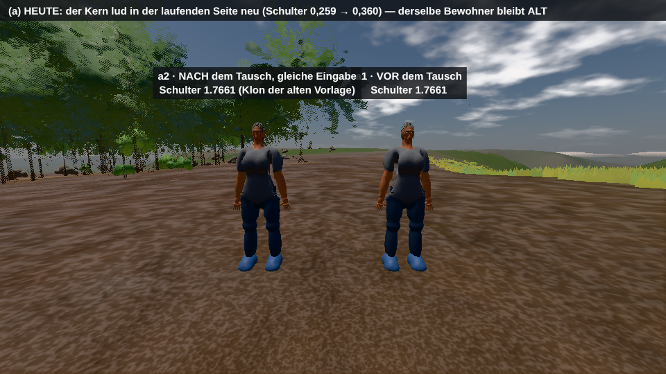
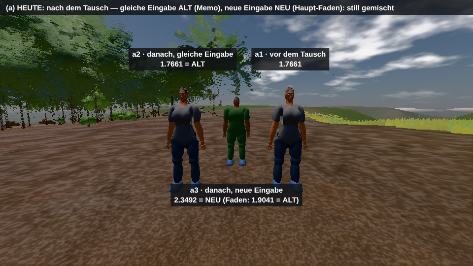
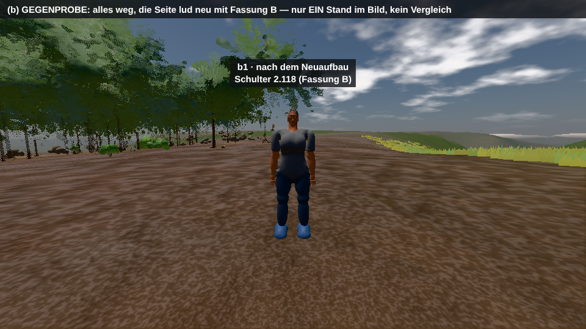
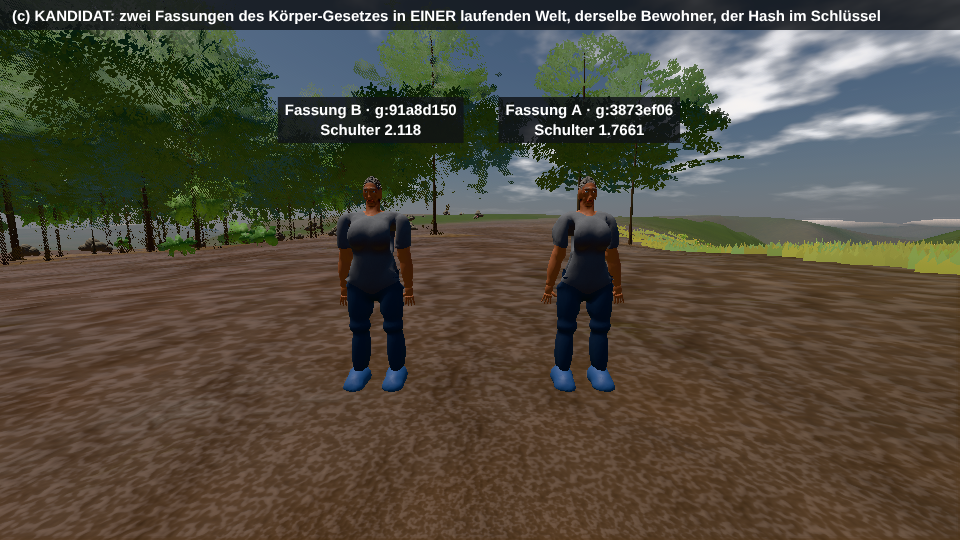
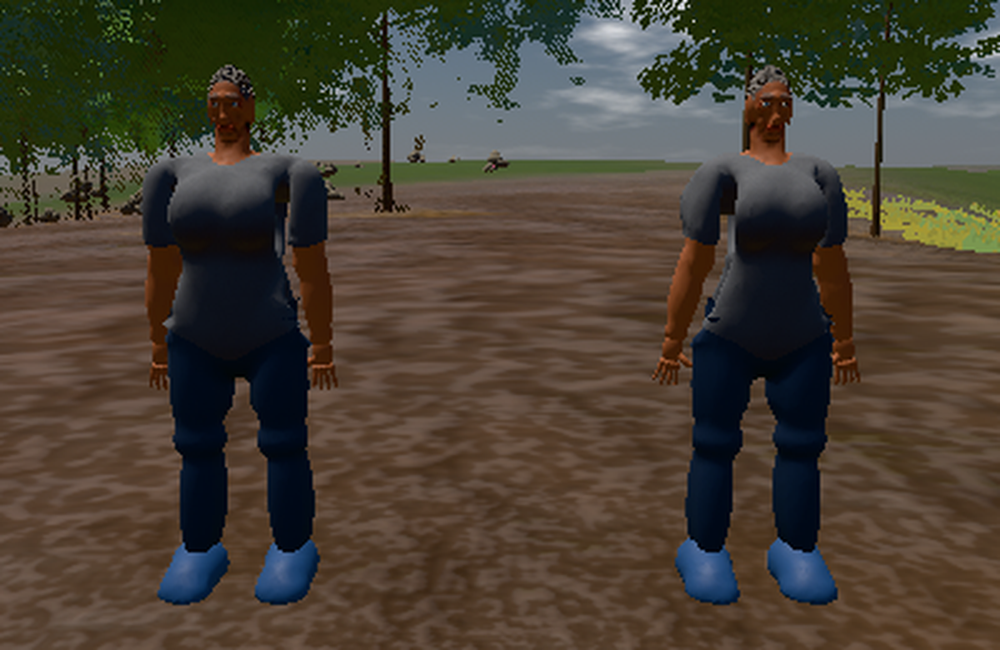

# SAMEN-BEFUND — Gesetz live tauschen, Direktvergleich im selben Bild

Zweig `w28-samen-live-tausch` · Stand V18.546.266 (main 4d52c7bc) · 12.11.2026 · nur Befund und Wegwerf-Spike, kein Schnitt im Kern.
Gerät: Cloud-Container, 4 Kerne, WebGPU auf swiftshader (`?holz=kienspan`), 1 Studio-Faden. **Frame-Zeiten sind CPU-Raster,
keine Karten-Zahlen**; alles andere (Zählungen, Schlüssel, Bytes, Bau-ms) hängt nicht am Renderer.

## In drei Sätzen

1. **Gelesen:** Die Fassung eines Gesetzes ist heute kein Wert, sondern ein Ort — EIN globaler Name je Faden, einmal je Start
   gefüllt; nur die Platte trägt sie seit dem 28.10. als SHA im Schlüssel, kein Speicher im Lauf tut es.
2. **Gemessen:** Der Kandidat trägt die GESTALT (zwei Fassungen, ein Bild, 2 Vorlagen neu, Umschalten 1,6–3,0 ms), aber 46 von 49
   Lese-Stellen des Körper-Gesetzes lesen am Chokepoint vorbei; der Datei-Hash baut 113 Lieferungen neu, wo sich 2 von 121 ändern.
3. **Ehrlich offen:** „Eine Landung trifft nur, was ihren Hash ändert" fällt aus dem Hash von Gesetz + Eingabe NICHT ab (11 von 12
   Landungen treffen eine Boot-Messung je Datei wie je ausgeführtem Glied) — das leistet nur der Hash des ERGEBNISSES.

## 1 · Fakten aus der Quelle (27 Zeilen, je Fakt eine)

**a) Wo abgeleitete Dinge entstehen — Rufer · Schlüssel · Speicher · wer macht ungültig**

- F1 Foundry-Körper (Baum, Bau, Wagen, Tier, Mensch): `_foundryRequest` (stamm/studio-bruecke.js:1255) → Faden → Transport-Schale (`_foundrySchale` :856) → Brücke `build-asset` (foundry-bruecke.js:1006) → Kern `buildInstance` oder `BAKERS_BY_KIND` (:862, foundry-core.js:9742).
- F2 Platten-Schlüssel (IndexedDB `anazhFoundryAssets/assets`, studio-bruecke.js:954): `f<FORMAT>|<kern>:<sha16>,…~<rest>` (:924–925); im Lauf wörtlich `f5|gelaende:e8d4f27fc920fb68,koerper:3873ef06677b44ae,phyto:899fe1b7e0acad65~mensch|0|0|ov:bde1c4f5.372`. Die SHA ist SHA-256 über die GANZEN Quell-Dateien je Kern (:943–948); FORMAT = 5 steht von Hand (:3520).
- F3 Ungültig macht das ÖFFNEN: weicht `__stamp` ab, löscht es jeden Schlüssel, dessen SHA kein Kern der laufenden Fassung trägt (:962–977) — die Platte hält EINE Generation.
- F4 Welche Kerne im Schlüssel stehen: die Basis (phyto = phyto-core + foundry-core + three + foundry-bruecke), die Eigner und jeder Kern, dessen Namen der Quelltext NENNT (`includes`, :946). foundry-core.js:7895 nennt `__koerperCore` (die Tier-Haut) → im Lauf tragen 124 von 124 Lieferungen `koerper` und `gelaende` im Schlüssel, auch der Blatt-Atlas und jede Eiche.
- F5 Speicher im Lauf `f.cache` (Map, LRU + Gewichts-Deckel, stamm/studio-gestalt.js:933/:962): Schlüssel `_foundryKoerperKey` = `<preset>|<gestalt>|<lod>[|ov:<fnv>.<länge>]` (studio-bruecke.js:1245) — ohne Gesetz; ungültig macht nur der Deckel.
- F6 Ofen (Mensch, Tier): `_ofenVorlage(key, …)` ist der EINE Weg ins Memo `AnazhRealm._tierOfenMemo` (stamm/koerper-leib.js:1298); Schlüssel `"mensch|" + lod + "|" + JSON(dials) + "|" + skin + "|" + hair` (:1896–1903, 296 Zeichen), das Tier `_ofenKreaturKey` (:1012) — ohne Gesetz; ungültig macht nur `_ofenMemoRaeumen` (:1356: ohne Leib, nicht `fest`, über 2 Ruhende).
- F7 Dieselbe Vorlage hat ZWEI Erzeuger: den Faden (`_foundryRequest("mensch", …)`, koerper-leib.js:1974, siedlung-bewohner.js:803) und den Guss im Haupt-Faden bei Memo-Miss (`BAKER.koerper(core, …)`, koerper-leib.js:1917) — den der Wirt selbst Bruch nennt (`FADEN-UMGANGEN`, stamm/dienst.js:602).
- F8 Karte: `_kartePlatteFragen` (stamm/stoff-karte.js:1133), Rest `"fimp|bc|" + z.key` (:1137), Platte wie F2; ihr Wert trägt dazu `w` = SHA über ALLE Stamm-Dateien + Engine, VERSION maskiert (studio-bruecke.js:1141–1144, Vergleich :1162): eine Landung, die eine der 64 Stamm-Dateien ändert (11 der letzten 12, `landung.txt`), backt jede Karte neu.
- F9 Gesetz-Strom `AnazhRealm.Gesetz(pfad)` (dienst.js:1989): Memo `_gesetzStromMemo` nach PFAD (:2014), nie ungültig (EINE Stelle im Baum); im Lauf 40 Pfade, 19 davon `koerper:`.
- F10 Stoff und Programm-Text: `_foundryMats[key]` (stamm/studio-stoff.js:201), key = phyto `budgetStoff(kind, mp)` + Wirts-Flaggen (:192–200) — ohne Gesetz; `HAUT_LOOK`/`HAAR_LOOK` des Körper-Kerns liest der Stoff bei seiner Geburt (:207, :370), danach stehen sie im Programm (`customProgramCacheKey` :538).
- F11 Fassungen von Hand: `"|v5"` im Wuchs-Plan (stamm/vegetation-streu.js:2260), `FOUNDRY_PLATTE_FORMAT = 5`, `?v=18.546.266` an 78 Stellen der index.html.
- F12 Der Stempel `_studioStampFor` (stamm/werkstatt-vorschau.js:864) ist Eingabe, kein Speicher: er reist als `ov`, sein Hash `_studioOvHash` (stamm/koerper-seele.js:1004, FNV-1a 32 Bit + Länge) steht im Rest (`|ov:bde1c4f5.372`). Die Eingabe ist also überall inhalts-gehasht; das Gesetz nur auf der Platte.

**b) Wege neben dem Chokepoint — `koerper-core.js` vollständig, die anderen als Stichprobe**

- F13 Im Stamm lesen 36 Stellen `__koerperCore` direkt (39 Zeilen − Namens-Tafel dienst.js:1968 − Kommentar speicher-welten.js:3918 − Folgezeile studio-stoff.js:208) und 13 Stellen über den Gesetz-Strom (`Gesetz("koerper:…")`): 49.
- F14 Durch den Leib-Chokepoint `_ofenVorlage` gehen 3 (koerper-leib.js:95, :1910, :1952). Daneben 46:
- F15 6 KOPIEN BEIM LADEN der Datei: koerper-leib.js:3278 (`MOTION_RIG_MAP`), :3319 (`PLAYER_KH`), koerper-bewegung.js:2666, :2667, :2671, :2676 (die Kapsel). Dazu die Zahl `6.0` = `H` des Gesetzes als Literal im Maßstab des Leibs (koerper-leib.js:140).
- F16 16 HALTEN EIN ERGEBNIS ohne Gesetz im Schlüssel: bau-vorlagen.js:1547 · koerper-bewegung.js:2597 (`_leibTaktMemo` = der ganze Kern, :2603) · koerper-fahrt.js:357 · koerper-leib.js:425, :1455, :1520, :1716 · siedlung-bewohner.js:242, :291, :326, :407, :869 · stoff-gang.js:375 · studio-stoff.js:94, :207, :370.
- F17 13 STROM-STELLEN (Memo nach Pfad, F9) mit Zweit-Memos dahinter (`_schwimmGesetzMemo`, `_bewegungsBlockMemo`, …).
- F18 11 LESEN JE RUF den globalen Namen und halten nichts: koerper-fahrt.js:164, :317, :343, :365 · koerper-leib.js:12, :66, :1481, :1556, :1589 · siedlung-bewohner.js:1765, :1777.
- F19 Kern liest Kern: foundry-core.js:7895 (Tier-Haut ← koerper `surfaceNets`), schmiede-core.js:2302 (Seil ← koerper `xpbdSchritt`); das Labor: worlds/koerperstudio/koerperstudio.js:10, :88.
- F20 Stichprobe (Nennungen des Kern-Namens im Stamm / Strom-Stellen): tetrapoda 41/3 · schmiede 32/1 · vehicle 10/1 · porta 6/6 · fachwerk 45/18 · klang 7/16 · terrain 22/28 · gelaende 103/0 · phyto 129/0 — mit koerper 434 Nennungen und 86 Strom-Stellen. Der Stamm trägt 96 Memo-/Cache-Felder; 4 davon setzt Code je zurück, an 3 Stellen (studio-bruecke.js:481, werkstatt-hof.js:283, werkstatt-vorschau.js:955).

**c) Wie der Kern in die Seite kommt, wer Zeiger hält**

- F21 `<script src="koerper-core.js?v=18.546.266" defer>` (index.html:10000): ein IIFE (koerper-core.js:17 … :7708), das EINEN globalen Namen füllt, `root.__koerperCore = {…}` (:7556); `?v=` setzt `npm run bump`. Der Kern liest selbst keinen anderen Global.
- F22 Zeiger über den Start hinaus (gemessen per Identität gegen 566 Objekte und Funktionen des alten Kerns): 26 Halter — 18 Einträge `_gesetzStromMemo<koerper:…>`, 4 `_bewegungsBlockMemo`, `_schwimmGesetzMemo`, `_gangZeileMemo.Z`, `MOTION_RIG_MAP` und `_leibTaktMemo`. Nicht per Identität sichtbar: die 5 Zahl-Kopien aus F15 und `_schwimmBrustMemo`.
- F23 Es gibt schon einen Live-Tausch — für den Stamm: `werkbank methode <name>` setzt EINE Methode am EINEN Prototyp (scripts/werkbank.cjs:2017–2028). Für die Kerne gibt es ihn nicht.

**d) Der Arbeiter-Faden**

- F24 Der Studio-Faden lädt die Kerne EINMAL: das Manifest per synchronem XHR (studio-bruecke.js:706), `importScripts` aller Kerne (:793), das Buch (PRESETS, Regler, Palette) einmal beim Start (foundry-bruecke.js:1041 → `f.recipes = book`, studio-bruecke.js:389), die SHA der Schale einmal (:943).
- F25 Je Auftrag liest die Brücke den Kern am globalen Namen des Fadens (`self[c.ns]`, foundry-bruecke.js:310–319): ein Neuladen im Faden würde sofort wirken — und die Schale stempelte weiter mit der SHA des Starts (aus der Quelle gelesen, nicht gefahren).
- F26 Kein Kanal für eine neue Fassung: die Brücke kennt 5 Nachrichten (`build-asset` · `get-book` · `export-settlement` · `slot-plan` · `blatt-atlas`, foundry-bruecke.js:1006–1025), die Schale fängt 4 (studio-bruecke.js:1183).
- F27 Fäden mit eigener Kopie des Körper-Kerns: „buch" und je vier Kerne ein „werk" (studio-bruecke.js:116, :272; hier 1). `voxel-worker.js` lädt phyto, gelaende, fachwerk (:51, :57, :328) — nie koerper; der Klang-Faden nur klang (stamm/klang.js:162).

**Gibt es EINEN Chokepoint?** Nein — vier (Schale · `_ofenVorlage` · `Gesetz` · `_foundryMats`) und daneben 35 Halter (F15–F17).
Nur die Schale sieht Schlüssel UND Bytes jeder gebackenen Sache.

## 2 · Urteil: die EINE Entscheidung

**Die Fassung eines Gesetzes ist ein ORT, kein WERT.** Ein Kern ist „der, der unter `__koerperCore` liegt" (koerper-core.js:7556),
einmal je Faden und Start. Daraus folgt alles andere: kein Schlüssel im Lauf KANN die Fassung tragen (F5, F6, F9, F10), der Faden hat
keinen Kanal für sie (F26), zwei können nicht nebeneinander stehen. Die drei genannten Verdächtigen sind Folgen davon, in dieser
Reihenfolge der Wirkung: der Schlüssel ohne Gesetz (macht den Tausch für jede bekannte Eingabe unsichtbar, Fall a), die Kopie je
Faden (baut dieselbe Eingabe alt), die 26 Zeiger und 6 Kopien. „Von Hand statt aus dem Inhalt" ist es NICHT: von Hand stehen nur 3
Fassungen (F11), und wo die Fassung ein Wert ist — auf der Platte —, liegen zwei schon heute nebeneinander (c2: A 22 ms, B 25 ms).

## 3 · Der Spike — EIN Kern, EINE Art, EINE Zahl

`labProportionen`: `shoulderHW = (0.259 * H) / 2` → `0.360` (koerper-core.js:1729). Die Art: ein Mensch auf dem Bau-Weg des Bewohners
(`_buildHumanGroup(ov)` unter ruhender Übergabe wie `_bewohnerGeburt`, siedlung-bewohner.js:831; die Dials aus
`_rollHumanoidGenome("samen-bewohner")`), am Genesis-Ort. Maß: die Breite des Leibs im Band 78–84 % seiner Höhe (Einheiten der
Vorlage; 1,7661 ≙ 0,5025 m gezeichnet, 2,118 ≙ 0,603 m). Zahlen aus dem vierten Lauf (`ergebnis.json`), die Läufe 2–4 stimmen überein.

| Fall | Tausch → Bild: Arbeit | + Frame (swiftshader) | neu gebaut | bleibt | Bild |
| --- | --- | --- | --- | --- | --- |
| **(a) heute** — der Kern lädt per `<script>` neu | 58 ms laden + 1,7 ms Klon | 60,5 s (erstes Bild mit den Programmen des Menschen; das zweite 18,8 s) | **0** — derselbe Bewohner ist ein Klon der ALTEN Vorlage (1,7661 = 1,7661) | alt: 2 von 2 Vorlagen · 26 Zeiger (0 auf den neuen Kern) · 6 Kopien · der Faden · 123 Platten-Dinge | `a-heute.png` |
| **(b) Gegenprobe** — die Seite lädt neu mit Fassung B | 74,2 s bis alles geliefert + 2,7 s Guss | 64,7 s | **alles**: 113 von 113 Lieferungen im Werk (Platte 0), 25 Chunks, die Szene — byte-anders davon **2 von 121** | nichts; verloren: 3 gestellte Menschen, 13 Ofen-Vorlagen, 103 Körper im Cache, 319 Szenen-Knoten | `b-neuaufbau.png` |
| **(c) Kandidat** — zwei Fassungen, der Hash im Schlüssel | 46 ms Fach laden + 3–7 ms SHA + 2 259 ms Guss B (im Faden 1 366 ms, von der Platte 25 ms) | 93,8 s | **2 Vorlagen** (lod 0 und 1) der Fassung B | 25 Chunks · 64 Körper im Cache · 56 Stoffe · die Spieler-Vorlage · der Faden A | `c-kandidat.png` |



(a) Links a2 (nach dem Tausch gebaut), rechts a1 (davor): dieselbe Vorlage, gemessen gleich (Gegenprobe `hybrid.json`: gezeichnete
Breite 0,5025 m = 0,5025 m, Schulter-Gelenke 0,3273 m = 0,3273 m — kein Zwitter aus alter Haut und neuem Rig). **Der Tausch ist für
jede bekannte Eingabe unsichtbar.**



(a) Dazu a3, ein ANDERER Bewohner nach dem Tausch: Memo-Miss → Guss im Haupt-Faden (1 530 ms, `FADEN-UMGANGEN`) mit dem NEUEN
Gesetz (2,3492); dieselbe Eingabe über den Faden gefragt: 1,9041 = ALT. **Welches Gesetz baut, entscheidet der Weg** — die Welt ist
still gemischt, ohne ein Wort im Log außer dem Faden-Bruch.



(b) EIN Stand im Bild, kein Vergleich. Die Platte: Boot mit B 0 Treffer / 113 im Werk; zurück auf A wieder 0 / 113 (B fegte A,
F3); erst der zweite Boot auf A 113 Treffer / 0. Nach INHALT verglichen (SHA-256 je Platten-Ding): A gegen A (zweimal frisch
gebaut) 0 von 120 anders — der Bau ist byte-stabil; A gegen B **2 von 121 anders** (`mensch|0|0|ov:d08c5185.321`, `mensch|0|1|…`).
Die Zeit bis zum Weltbild unterscheidet hier nichts (62–76 s in jedem Boot, kalt wie warm: der 60-s-Deckel und das CPU-Raster
tragen sie); auf der Karte heißt derselbe Unterschied 16,6 s kalt gegen 12,0 s Zweit-Boot (GTX, CLAUDE.md B).




(c) Links Fassung B (`g:91a8d150`, 2,118), rechts Fassung A (`g:3873ef06`, 1,7661), derselbe Bewohner, EINE laufende Welt. Der
Spike legt von außen an: je Fassung ein Fach (der IIFE-Fuß liest ein eigenes `self`), der EINE Key-Münzer `_ofenMenschKey` hängt
`|g:<sha16>` an, der Bau läuft „unter einer Fassung". Ein zweiter Bewohner nach B trifft die Vorlage (Klon 1,7 ms). **Umschalten**
eines stehenden Leibs A ↔ B: 2,9 · 2,8 · 3,0 · 1,6 ms. **(c2) der Faden:** ein zweiter Studio-Faden aus demselben Boot-Blob, dessen
Kerne aus einem Baum mit Fassung B laden, steht nach 359 ms; dieselbe Frage an beide: A 1,7661 (1 461 ms im Werk), B 2,118
(1 366 ms), beim zweiten Mal beide von der Platte (22 ms, 25 ms) unter `…koerper:3873…~mensch|0|0|ov:bde1c4f5.372` und
`…koerper:91a8…~…`. Aber sein ÖFFNEN fegte **139 von 139** Einträgen der Fassung A.

### Was beim Kandidaten NICHT mitkommt (las am Chokepoint vorbei)

1. **Der Stoff.** Der Bau von A las `HAUT_LOOK` 4×, `HAAR_LOOK` 1×, `haarLappen` 2×; der Bau von B **0×** — B trägt die Stoffe und
   Programme der Fassung A aus `_foundryMats` (F10). Ein Look-Gesetz der Haut wäre im Bild NICHT getauscht.
2. **Alles nach dem Bau.** Der Leib trägt keine Fassung; danach gilt wieder `window.__koerperCore` = A, `_leibTakt()` = A,
   `MOTION_RIG_MAP` = A. Gang, Tuch, Tages-Plan des B-Leibs rechnen mit A (die 11 Je-Ruf-Leser F18 und `_leibTaktMemo`).
3. **Der Strom und die Kopien.** Im B-Bau kam `koerper:DIAL_MAP` aus dem Memo des Starts (A); 25 Zeiger zeigen auf A, 0 auf B; der
   Maßstab des B-Leibs rechnet mit `PLAYER_KH` und `6.0` aus A (F15).
4. **Der Faden.** Er kennt B nicht (F26). Der Spike goss B darum im Haupt-Faden: 2,3–2,6 s Hänger je Fassung, vom Wirt je Guss als
   `FADEN-UMGANGEN` gemeldet. Ein Faden je Fassung trägt (359 ms), scheitert aber am Fege-Stempel der Platte (F3).
5. **Die Feinheit.** Der B-Bau liest 28 Namen des Kerns (7 630 Lesungen, 7 508 davon `menschTon`) — `labProportionen`, das geänderte
   Gesetz, ist NICHT darunter: der Kern liest es in sich selbst. Am Namensraum ist nicht zu sehen, welches Teil-Gesetz ein Ding
   trank; der Hash kann nur die ganze Datei sein. Folge, gemessen: 113 neu gebaut, 2 anders.

## 4 · Urteil in fünf Sätzen

1. **Trägt der Kandidat?** Für die Gestalt ja — zwei Fassungen in einer Welt, 2 Vorlagen neu, alles andere unberührt, Umschalten
   in 3 ms; als „Gesetz live tauschen" nein, solange 46 von 49 Lese-Stellen neben dem Chokepoint lesen: Stoff, Verhalten und Maße
   des neuen Leibs blieben Fassung A.
2. **Was kostet er im Normalbetrieb?** Fast nichts: der Schlüssel 1,16 → 1,52 µs je Münzung (andere Läufe 1,41 → 1,38 und
   2,36 → 3,00) und +19 Zeichen (296 → 315; bei 13 + 104 Einträgen etwa 4 kB), die SHA je Kern-Datei 2–14 ms für 474 kB einmal je
   Start (der Faden rechnet sie schon); ein Inhalt-Hash je gebackener Sache 1,2–2,9 ms (120–123 Dinge, 27–30 MB in 147–346 ms samt
   Lesen aus der Platte) und 8 Byte.
3. **Wo reißt er?** Am Faden (kein Kanal; die Platte fegt je Öffnen 139 von 139), an den 35 Haltern und 11 Je-Ruf-Lesern neben dem
   Chokepoint, am zweiten Erzeuger im Haupt-Faden (F7) — und an der Feinheit: der Datei-Hash samt `nennt` (F4) trifft bei jeder
   Änderung an koerper, gelaende, phyto, foundry-core oder der Brücke 100 % der Platte, und 4 der letzten 12 Landungen ändern eine
   dieser Dateien (`landung.txt`).
4. **Der EINE Schnitt und was stirbt.** Die Fassung wird ein Wert an der Lade-Naht — ein Register `(Kern, SHA) → Namensraum` je
   Faden, der globale Name bleibt als Zeiger auf „die geltende" — und jeder Speicher im Lauf übernimmt den Schlüssel, den die
   Schale ohnehin rechnet (ihre Liefer-Marke trägt dann SHA + Rest), statt einen eigenen zu münzen; es sterben `_ofenMenschKey` und
   `_ofenKreaturKey` als eigene Münzer, der Guss im Haupt-Faden (F7), der Fege-Stempel (Alter statt Stempel), das Pfad-Memo des
   Stroms, `_leibTaktMemo`, die 6 Kopien beim Laden und `|v5`. Das ist KEIN System neben dem alten: es ist das Platten-Gesetz vom
   28.10., in den Lauf verlängert.
5. **Was fällt als Nebenwirkung ab?** „Speicher der Ankunft nach Hash" ja — die Platte IST schon inhalts-adressiert, ein Eintrag
   unter seinem Schlüssel gilt für immer und ließe sich ausliefern (der Ship-Haken `__anazhLiveBake === false` steht,
   studio-bruecke.js:1267); es fehlen nur die zweite Generation (F3) und die Feinheit (F4). „Eine Landung trifft nur, was ihren Hash
   ändert" NEIN: je ausgeführtem Glied geurteilt treffen 11 von 12 Landungen eine Boot-Messung, genau wie je Datei (`spur.txt`; die
   Messung führt 1 999 von 3 973 Methoden aus, 50,3 %) — treffsicher ist nur der Hash des ERGEBNISSES (2 von 121).

## 5 · Trägt er die Macher-Schleife? Nein — was sie stattdessen verkürzt

Der Kandidat verkürzt die Look-Schleife an einem Kern (ändern → sehen, Arbeit ohne den Frame: 2,3 s statt 76,9 s Neuaufbau; mit
Faden-Kanal 1,4 s, von der Platte 25 ms). Die vier gemessenen Wartezeiten — Ofen-Vertrag 8–20 min, `npm run check` 10 min, GPU-Schloss 10 min und länger,
83 von 118 alte Urteile je Landung — berührt er nicht: sie sind Prüf-Durchsatz, kein Bau.

Was dort die größte Zahl bewegt, nach dem, was dieser Befund gemessen hat:

- **Das Urteil merkt sich die Inhalt-Hashes der Dinge, die es SAH, nicht die Dateien, die es lud.** Nach einer Landung baut ein
  CPU-Lauf ohne GPU-Schloss die Dinge neu und vergleicht: hier 2 von 121 anders, A gegen A 0 von 120 (der Bau ist byte-stabil, der
  Vergleich kostet 0,2 s). Ein Urteil über Eiche, Haus oder Wolf bliebe nach dieser Körper-Änderung frisch; je Datei geurteilt wird
  es alt. Die Naht dafür gibt es: die Schale sieht jede Lieferung mit Schlüssel und Bytes (studio-bruecke.js:1090).
- **Die Feinheit der Platte.** `nennt` per Text-Suche (F4) hängt jede Eiche an den Körper-Kern, weil foundry-core ihn für die
  Tier-Haut nennt: 113 Lieferungen neu für 2 geänderte. Fällt das, bleiben Macher-Boot und Ankunft über 4 von 12 Landungen warm.
- **Der Stamm ist schon so weit:** eine Landung ändert im Mittel 2,2 von 64 Dateien, aber 5,7 von 4 783 Gliedern (0,12 %), und
  `werkbank methode` tauscht ein Glied live. Den Kernen fehlt genau dieses Werkzeug — der Kandidat (c) wäre es.

## Grenzen dieser Messung

- swiftshader im Container: Frame-Zeiten (18–94 s je Bild) und die Zeit bis zum Weltbild (60-s-Deckel) sind keine Geräte-Zahlen;
  kein Lauf auf OMEN oder Radeon. Je Fall EIN Lauf je Durchgang, vier Durchgänge; Zählungen und Bytes waren in jedem gleich
  (Platte 0/113 · 113/0–7, anders 2), die ms schwanken (Guss 1,9–3,5 s).
- Die Art ist ein Mensch auf dem Bau-Weg des Bewohners, nicht eine Siedlung im Takt: der Mengen-Satz (Stufen 2 und 3,
  `_bewohnerRaum`) und der Welt-March sind nicht gefahren.
- Der Zweig `koordination` ließ sich hier nicht holen (zwei Versuche, die Übertragung brach ab): die Systemkarte und der Apparat
  der Mess-Urteile sind NICHT gelesen. Die Aussage zu den 83 von 118 stützt sich auf `landung.txt` und `spur.txt`, nicht auf den
  Urteils-Code; die Abdeckung sieht nur den Haupt-Faden.
- Der Zeiger-Zensus findet Objekte und Funktionen, keine kopierten Zahlen und keine Closures.

## Wiederholen

```bash
node samen/live-tausch/spike.cjs      # die drei Fälle, ~10 min, schreibt ergebnis.json und die PNG
```

```bash
node samen/live-tausch/hybrid.cjs     # Gegenprobe zu (a): alte Haut auf neuem Rig? (Null-Renderer)
```

```bash
node samen/live-tausch/landung.cjs 12 # je Landung: Dateien gegen Glieder
```

```bash
node samen/live-tausch/spur.cjs 12    # die Lese-Spur einer Boot-Messung gegen die Landungen (~5 min)
```
