# SAMEN-BEFUND Wiese — Gras-Halm und Baum-Stamm

Stand 12.11.2026 · Basis `3552f058` (V18.546.263) · Befund und Wegwerf-Spike, kein Schnitt im Kern, keine Abgabe.
Gebaut über die echte Brücke (`scripts/lib/asset-worker-harness.cjs`), gezeichnet nackt im Streiflicht (three r184 WebGL,
swiftshader; Sonne 14° am Gras, 16–22° am Baum; kein Stoff der Welt, kein Wind). Das Welt-Bild stammt aus
`origin/koordination:probe-post/w28-nadel-stufe/7c51bdec-wiese-0.5.png` (GTX 1050, 11.11.).

## 1 · Fakten (Datei:Zeile, Zahl)

**Halm** (ein nacktes `:Zeile` meint `foundry-core.js`)
1. Vokabular: EIN flaches Band je Halm, `K` gleich lange Schritte, zwei Ecken je Zeile, die Spitze eine Ecke — `foundry-core.js:3205–3248`. Kein Querschnitt in der Geometrie.
2. Die Welt bekommt L0 nie: `kindStages.grass: [1, 2]` (`foundry-core.js:435`). L1 trägt 0–5 m, L2 5–10 m (`stamm/daten.js:549, 551`).
3. Stufen (`HALM_STUFEN`, `foundry-core.js:3123–3127`): L0 10 Segmente · Breite ×1 · L1 3 Segmente · Breite ×3,0 · L2 1 Segment · Breite ×12,65 (aus der Flächen-Gleichung `:3136–3142`).
4. Breite in der Welt = `bladeW 0,0675 · wMul · 0,74 · 0,24` (`:3187, :5037, :673`): L0 12 mm · **L1 36 mm** · **L2 152 mm**; mit Büschel-Skala 0,7–1,4 (`stamm/vegetation-wiese.js:151`) 25–50 mm. Die Natur laut Kern 3–6 mm (`phyto-core.js:6274`).
5. Länge `1,72 · 0,6–1,15 · 0,24` = 0,25–0,47 m (`:3186, :5036`) → Schlankheit L/B an der L1 **10,8** (Nachbau, Median); 4 mm × 0,35 m wären 88.
6. Halme je Büschel `round(lerp(50, 150, density) · anteil)` (`:3159`): L1 110, L2 40, auf einer Scheibe von 0,52 m Radius (`clump`, `:5042`), ein Büschel je 0,72-m-Zelle (`:658`) → 212 Halme/m².
7. Dreiecke je Halm 2K − 1: L1 5, L2 1. Gebaut: L1 601 / 737, L2 61 / 66, L0 2 460 / 2 938 (Samen 1 / 2). Budget L1 1 000, L2 130 (`:579–580`).
8. Krümmung: die Biegung fällt JE SCHRITT an (`dir += bendDir · f^1,8 · droop · 0,12`, `:3207–3212`), nicht je Bogenlänge. Gemessen (Nachbau, flächen-gewichtet, Winkel Fuß ↔ Spitze): K 3 **6,7°**, K 10 17,2°. Die Stufen fahren dieselbe Funktion, aber NICHT dieselbe Kurve.
9. Jenseits 10 m zeichnet der Wirt eigene Formen: gestreckte L2-Büschel bis 200 m und Schalen-Karten zu 13 Dreiecken (`stamm/daten.js:528–531, 557–581`).
10. Farbe je Ecke: Fuß `0,6 · seasonTint` → Spitze `1,08 · seasonAccent` (`:3160–3161, :3227`); je Halm Helligkeit 0,72–1,28, Ton ±0,5 auf R und −1,2 · Ton auf B (`:3046, :3228–3230`); 30 % der Halme mischen 40–90 % Stroh (`:3046, :3232`).
11. Schattierung: Kiel und Rippen kippen nur die Normale im Stoff (`phyto-core.js:6301`, `stamm/stoff-material.js:29`); zwischen 1 und 3 mm je Pixel (ab etwa 2,1 m ganz) kippt sie zu 0,9 nach oben, Rauheit 1 (`phyto-core.js:6277, 6290`, `stoff-material.js:31–33`). Durchlicht `tauLaub 1,0` über `_laubLichtStoff` (`stamm/studio-stoff.js:756`, `phyto-core.js:6231`). Keine Normal-Karte (Brücke: `hasNormalMap false`).

**Ton**
12. Gras und Laub lesen DIESELBE Jahres-Quelle: `vcol · uSeasonMul` (`stamm/studio-stoff.js:299, 314`), Sommer = ×1 (`stamm/bild-himmel.js:848`). Die Jahreszeit widerspricht sich nicht in der Quelle.
13. Der gelbe Ton steht in der Albedo (Brücken-Bau, linear, flächen-gewichtet): Laub Eiche `#507b2e` R/G 0,41 · Halm ganz `#69813d` R/G 0,64 · **Ähren `#c2ad76` R/G 1,30** (linear 0,54 / 0,42 / 0,18 gegen Laub 0,08 / 0,20 / 0,03; `seedTan 0xc8b27a`, `foundry-core.js:5045, 3321`).
14. Über der halben Büschel-Höhe sind 46 % der Fläche Ähre; dort steht `#9e9f63` (R/G 0,99). Der Standort-Tint der offenen, trockenen Wiese legt R/G × 1,23 darauf (`wiesenTint`, `foundry-core.js:3071–3096`; 40 000 Orte, Licht 1, Feuchte 0) → `#b0a156`.

**Stamm**
15. Radius-Gesetz: `trunkR = hoeheM / hd / 2 / weltSkala` (`phyto-core.js:102`), Solitär `height / (hd · 0,45) / 2` (`:101, :2458`). `hd`: Eiche 60, Fichte 70, Birke 80, Buche 70 (`foundry-core.js:4640–4670, 4941`). Die Krone steht in keinem Term.
16. Die Krone wächst unabhängig: Seitenast × 0,6 und Kronen-Hub 0,6 im Bestand (`phyto-core.js:2466`), jeder Ast-Radius relativ zum Stamm (da Vinci, `:87, :272`).
17. Gemessen (Ring-Mitten `aCenter`, Eiche L0): Bestand Same 1 H 17,31 m · BHD 0,238 m · H/BHD 72,7 · Krone 9,2 m · **Krone/BHD 38,6**. Solitär Same 3 H 13,31 m · BHD 0,420 m · H/BHD 31,7 · Krone 17,6 m · **Krone/BHD 41,9**.
18. Weitere Arten (Hüll-Maß, `mass.cjs`): Buche H/BHD 78, Birke 90, Fichte 77.
19. Verjüngung `rEnd = radius · 0,93` je Lauf (`phyto-core.js:114`): 0,238 → 0,203 m über 4,2 m (0,8 cm/m), an der ersten Gabel (6,0 m) fällt der Leittrieb auf 0,110 m.
20. Wurzelanlauf `ffR(y) = 1 + flare · 0,85 · e^(−y/fh) + flare · 0,5 · e^(−y/0,35 fh)`, `fh = 0,14 · H` (`foundry-core.js:2376–2379`), `flare = lerp(0,16; 0,52; 1 − slim)` (`phyto-core.js:2100`), dazu Flöten 0,7–1,62 (`phyto-core.js:3861–3862`). Gemessen am Boden ⌀ 0,275 m im Mittel (0,141–0,538) = 1,16 × BHD.
21. Ringe am Schaft alle 0,60 m, 27 Seiten (`phyto-core.js:3686–3706`): der Anlauf trägt EINEN Ring zwischen 0 und 0,6 m — ein Stern-Kegel.
22. Rinde: Relief als Ecken-Versatz `r · (1 + (relief − 0,62) · tiefe + narbe) · flute` (`phyto-core.js:3875`), AO in der Ecken-Farbe (`phyto-core.js:3847`), Normal-Karte im Stoff (Brücke: `hasNormalMap true`), Rauheit 0,93.
23. Budget `tree` L0 12 000 · L1 2 900 · L2 Karte 2 (`foundry-core.js:492, 504, 516`). Gebaut Eiche L0 6 954 (Rinde 6 660, Laub 294), L1 1 758 samt Wurf-Teil. Der Schaft 0–6 m trägt etwa 540 Dreiecke, 8 % der Rinde.
24. Die Stufen erben dasselbe Skelett (`phyto-core.js:2222–2223`); kein Zwilling am Stamm.

## 2 · Bilder — SIEH (der Bau des Kerns)

Die Welt (GTX 1050, Ort `wiese`, Uhr 0,5):
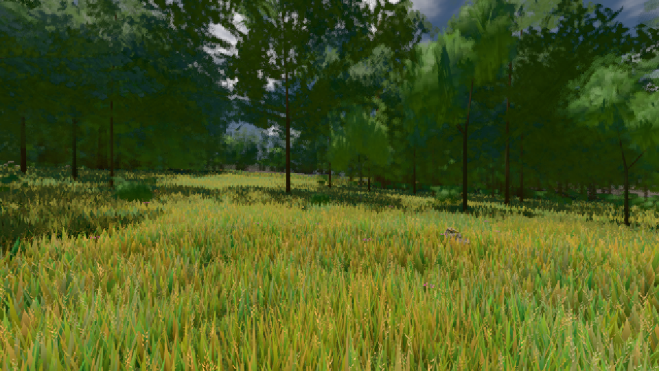

Ein Büschel L1 aus 1,6 m Höhe auf 1 m · ein Büschel L2 auf 10 m (Ausschnitt, 9° Sichtfeld):
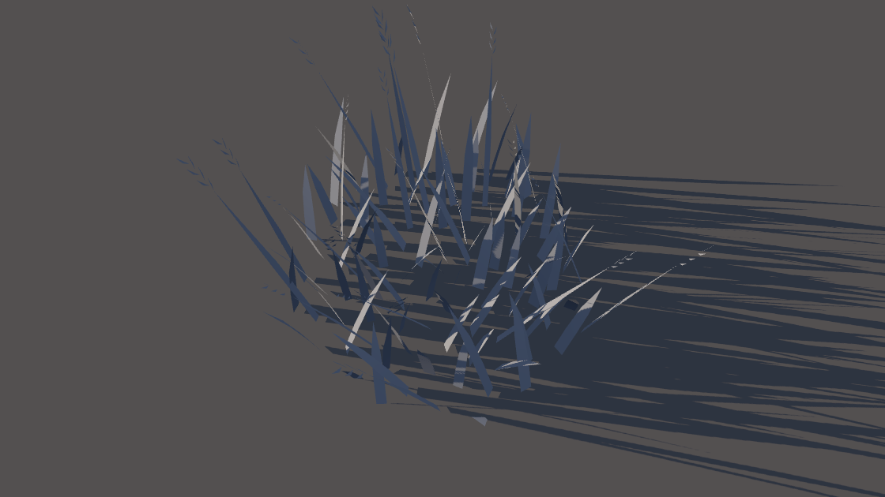
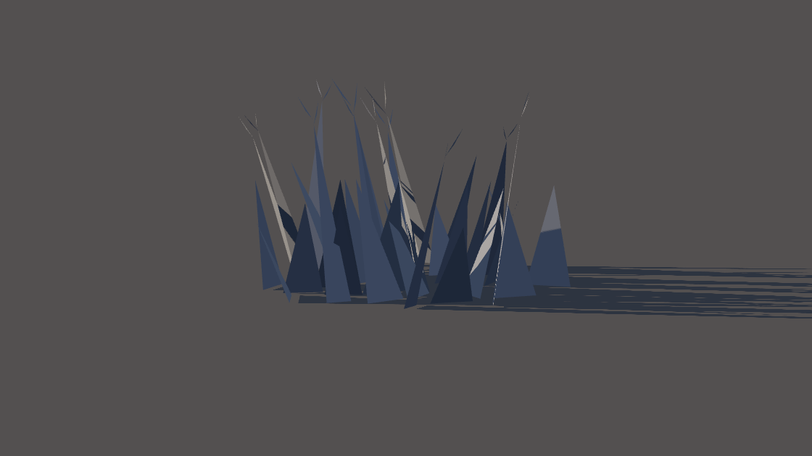

Das Feld wie der Wirt es wirft (L1 bis 5 m, L2 dahinter), Blick auf 1 m und auf 10 m:
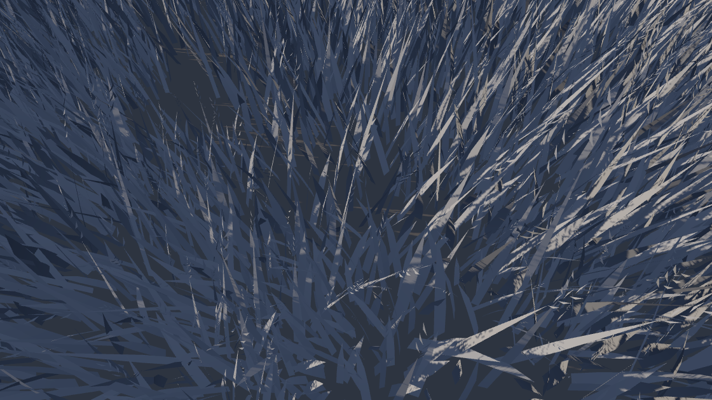
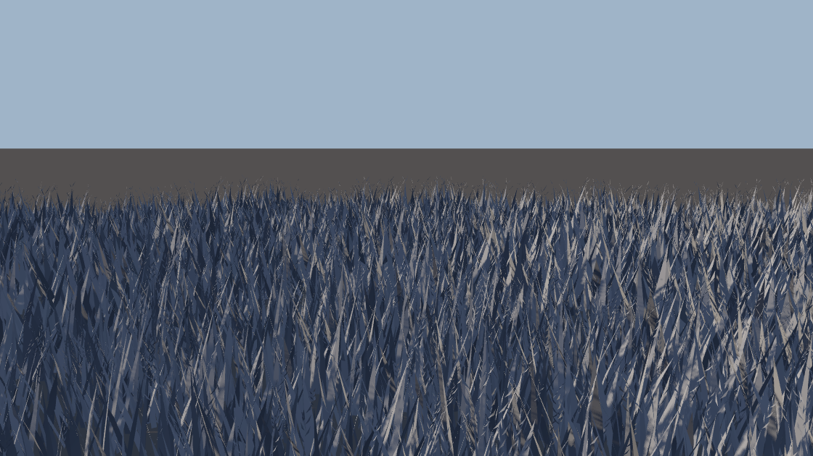

Eiche Bestand (Same 1) ganz und ihr Fuß aus 3,4 m · Eiche Solitär (Same 3):

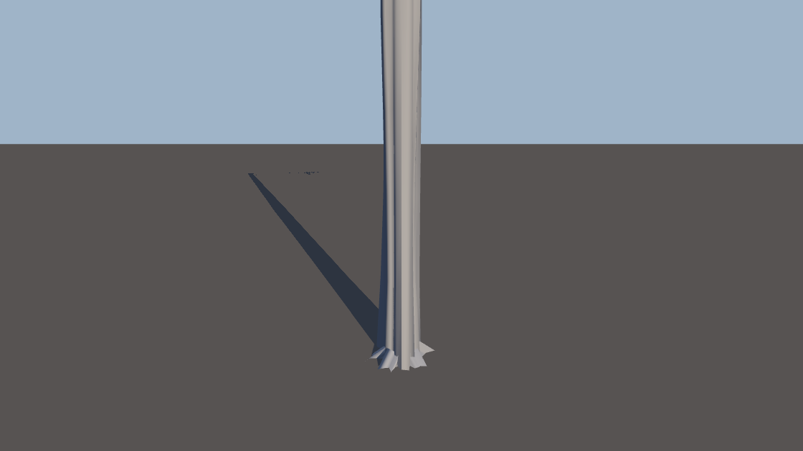
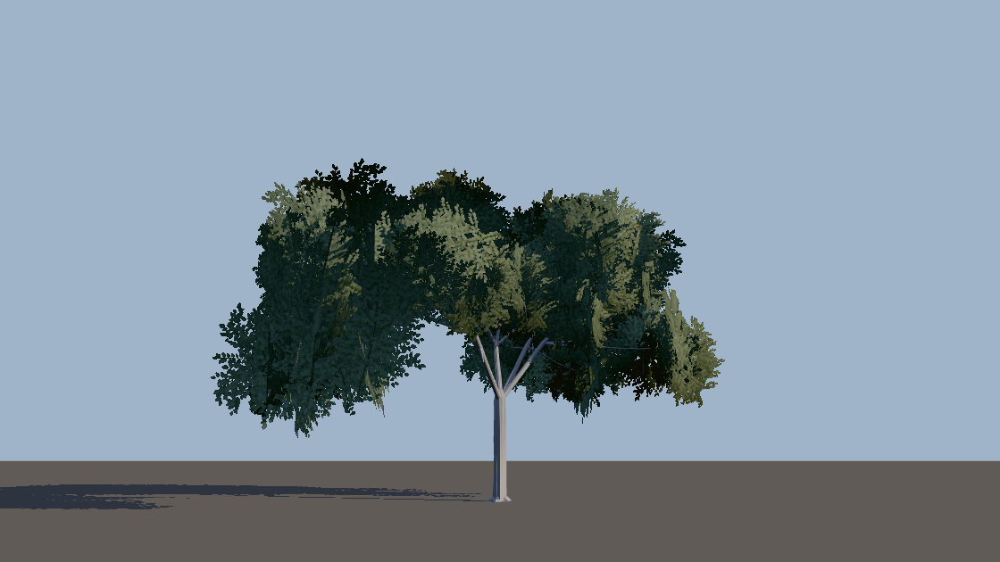

Was ich sehe: gerade, breite Lanzen mit einer Dreiecks-Spitze; auf 10 m eine Palisade aus Wimpeln. Der Stamm ist eine geriffelte
Stange mit einem Stern am Boden; der Solitär trägt einen 17-m-Schirm auf 42 cm.

## 3 · Urteil — die EINE Samen-Entscheidung

**Halm:** Die Stufe trägt die Blattfläche über die BREITE des Einzel-Halms (`HALM_STUFEN.breite` 3,0 und 12,65 bei fester Halm-Zahl).
Der Halm ist damit ein Flächen-Träger, keine Gestalt: 36 mm breit, Schlankheit 10,8, 6,7° Bogen.

**Stamm:** Der Radius folgt der HÖHE (`H / hd`) und kennt die Krone nicht, die er trägt. H/BHD liegt im Band des Kerns, Krone/BHD
liegt beim Doppelten des Richtwerts — der Stamm ist nicht absolut zu dünn, er ist zu dünn für SEINE Krone.

## 4 · Spike Halm — drei Fälle am selben Büschel

Dieselben 110 Füße, Richtungen und Längen (Nachbau der Regel in `halm.cjs`, ohne Ähren; der Bau des Kerns steht oben daneben).
Form-Maße: **Schlankheit** L/B (das Auge liest Gras an der Linie, nicht an der Fläche) und **Bogen** (Winkel Fuß ↔ Spitze).
LAI und Boden-Frei (Anteil Boden-Pixel im Ego-Bild auf 1 m) halten die Deckung gleich.

| Fall | Dreiecke | Ecken | Blätter | Breite (Median) | Schlankheit | Bogen | LAI | Boden frei | Bau (Nachbau, Node) |
|---|---|---|---|---|---|---|---|---|---|
| (a) heute: K 3, Breite ×3,0 | 550 | 770 | 110 | 33,0 mm | 10,8 | 6,7° | 1,98 | 21,0 % | 1,5 ms |
| (b) Gegenprobe: K 10, Breite ×3,0 | 2 090 (×3,8) | 2 310 | 110 | 33,0 mm | 10,8 | 17,2° | 2,06 | 19,7 % | 2,1 ms |
| (c) Kandidat „Trieb" | 550 | 1 210 | 330 | 16,6 mm | 17,6 | 21,7° | 1,97 | 18,7 % | 4,3 ms |

Der Kandidat: je Fuß ein TRIEB aus drei schmalen Blättern, die die Fläche des einen breiten Halms teilen — ein langes Blatt im
Bogen (2 Segmente, 3 Dreiecke) und zwei junge, gerade (je 1 Dreieck). Die Mittellinie ist ein Gesetz in Halm-Koordinaten,
Neigung θ(s) = θ0 + Θ · s² über dem Bogen-Anteil s; die Stufe tastet sie ab und integriert sie nicht neu.
Verworfen: fünf gerade Nadeln je Fuß (Schlankheit 24,1, Bogen 0° — liest als Fell) und ein Bogen-Blatt in voller Breite
(Bogen 47,9°, Schlankheit 9,6 — liest als Bärlauch).

| | Büschel auf 1 m | Feld auf 1 m | Feld auf 10 m |
|---|---|---|---|
| (a) | 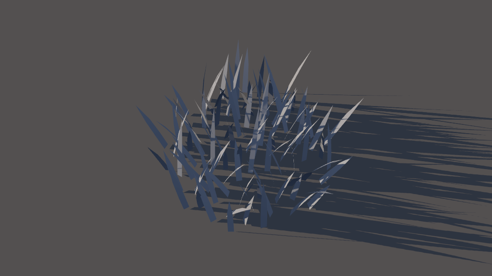 | 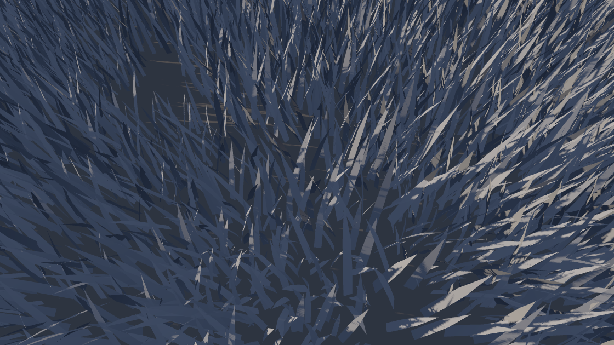 | 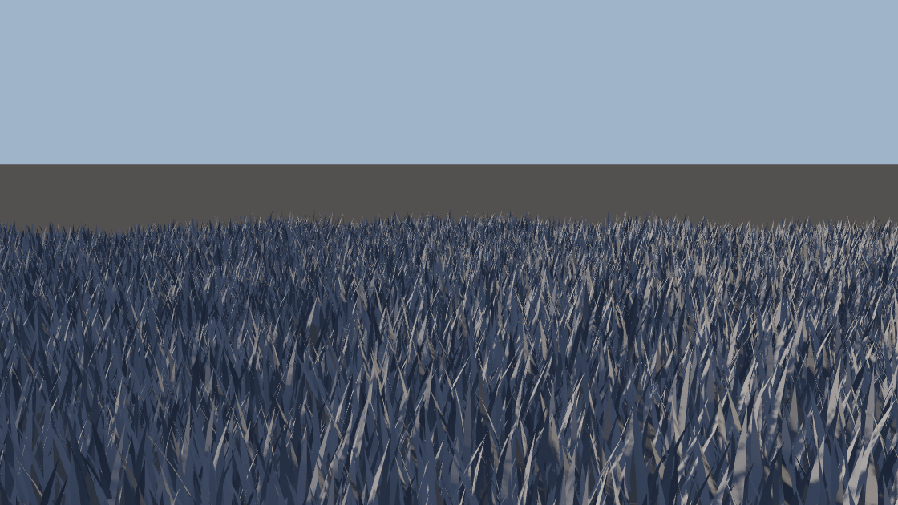 |
| (b) | 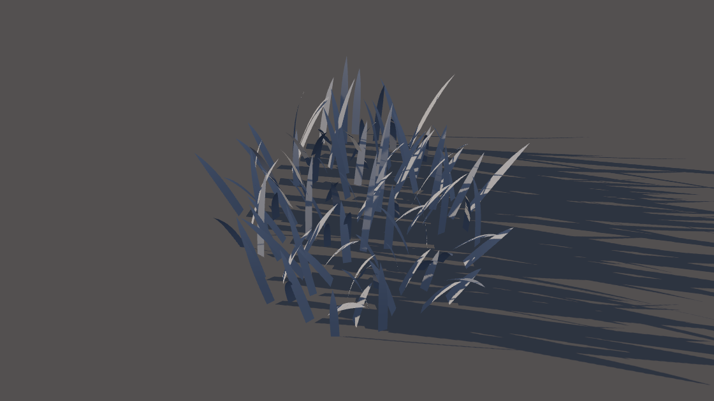 | 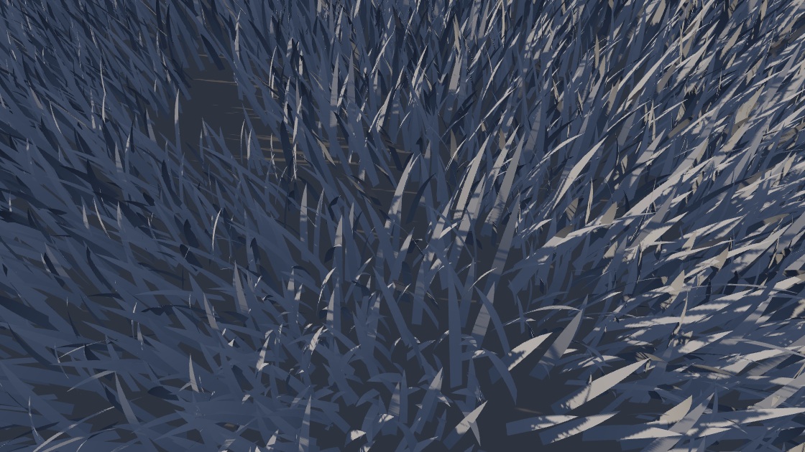 | 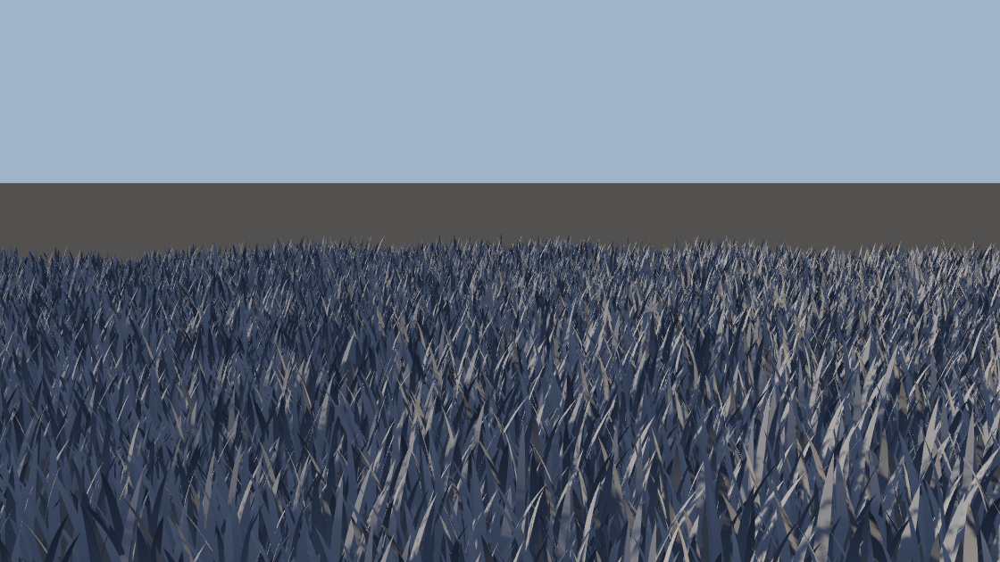 |
| (c) | 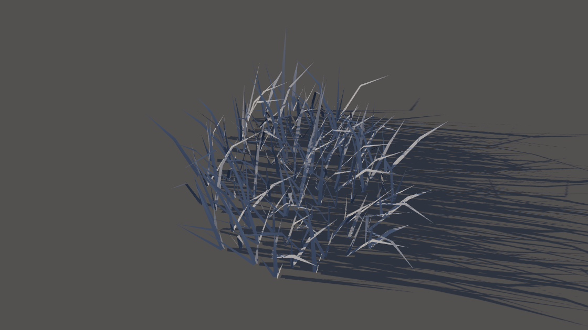 | 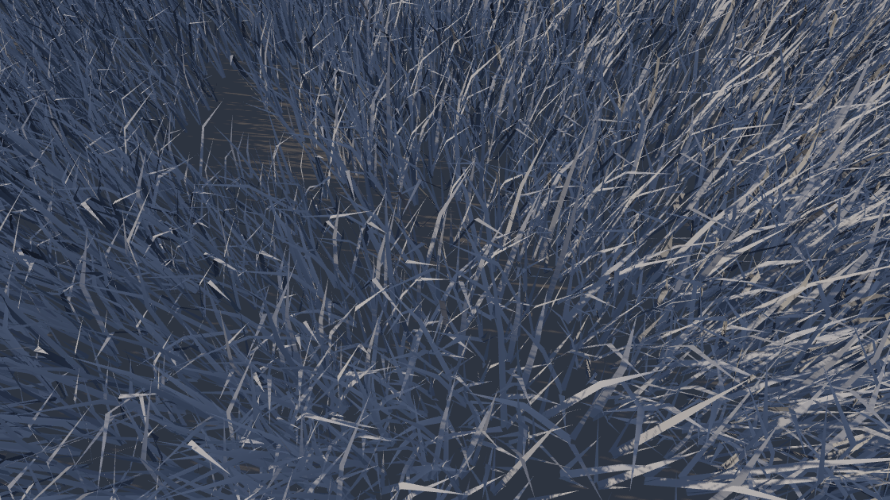 | 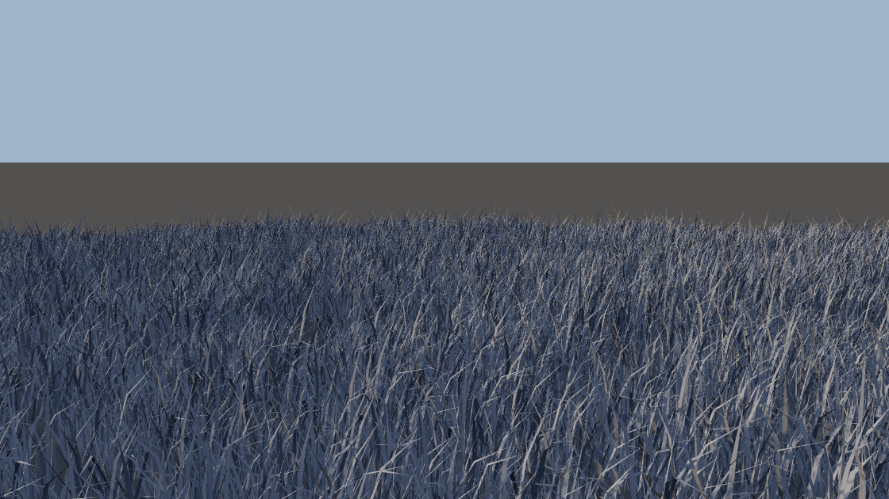 |

Die Feld-Bilder des Spikes tragen die L1-Form bis 14 m; die Welt wechselt bei 5 m auf L2.

**Urteil Halm.** Der Kandidat trägt bei gleichem Budget: 550 Dreiecke, dieselbe Blattfläche, das Feld liest als Gras statt als
Lanzen, während 3,8-mal mehr Dreiecke nur weichere Lanzen geben. Er kostet 57 % mehr Ecken (770 → 1 210, Wind und Jahr rechnen
je Ecke) und dünnere Dreiecke; die Pixel-Arbeit auf echter GPU ist NICHT gemessen. Er reißt an drei Stellen: das Bogen-Blatt
hat EINE Innen-Ecke und knickt um 16–59° wie ein Strohhalm, das Blatt bleibt mit 17 mm knapp drei- bis gut fünfmal so breit wie die Natur (3–6 mm),
und an der L2 trägt er gar nicht — sie ist schon ein Dreieck je Halm, ihre 152 mm folgen aus der Fläche, die Naht bei 5 m wird
härter. Der EINE Schnitt im Kern wäre `emitGrass` (`foundry-core.js:3174–3248`): die Fläche einer Stufe verteilt sich auf die
Blätter eines Triebs, die Mittellinie wird Gesetz. Dabei sterben `HALM_STUFEN.breite` als Flächen-Träger und die Schritt-Biegung,
die Gras-Goldens werden neu geprägt, und die L2 braucht eine eigene Antwort.

Der Ton liegt außerhalb dieses Schnitts: er ist Albedo (Ähren `#c2ad76` auf 46 % der oberen Fläche, Tint × 1,23), nicht Form.

## 5 · Spike Stamm — drei Fälle am selben Baum

Eiche L0 über die echte Brücke. Der Kandidat fährt über ihren Regler-Kanal: `ov.trunkMul` 2,0 (Bestand) und 2,2 (Solitär),
abgeleitet aus BHD = Kronen-⌀ / 20. Kronen-⌀ = 2 × das 90. Perzentil des Achs-Abstands der Laub-Ecken.

Richtwerte, alle **UNGEPRÜFT**: H/BHD im Bestand 40–100 (zitiert aus `phyto-core.js:84`, dort „waldwissen, McMahon 1973", von mir
nicht nachgeschlagen), Solitär 15–35 (Gedächtnis); Kronen-⌀/BHD bei Laubbäumen 15–25 (Gedächtnis).

| Baum | Fall | Dreiecke | Seiten · Ring-Abstand | H | BHD | BHD/H | H/BHD | Krone/BHD | Fuß/BHD | Bau über die Brücke |
|---|---|---|---|---|---|---|---|---|---|---|
| Bestand | (a) heute | 6 954 | 27 · 0,60 m | 17,31 m | 0,238 m | 0,0138 | 72,7 | 38,6 | 1,16 | 212 ms |
| Bestand | (b) Ringe ×2, Seiten ×2 | 26 934 (×3,9) | 54 · 0,30 m | 17,31 m | 0,237 m | 0,0137 | 73,0 | 38,8 | 1,14 | 212 + 34 ms |
| Bestand | (c) Stamm aus der Krone | 6 954 | 27 · 0,60 m | 17,31 m | 0,474 m | 0,0274 | 36,6 | 19,4 | 1,13 | 191 ms |
| Solitär | (a) heute | 6 016 | 27 · 0,71 m | 13,31 m | 0,420 m | 0,0315 | 31,7 | 41,9 | 1,15 | 109 ms |
| Solitär | (b) Ringe ×2, Seiten ×2 | 22 378 (×3,7) | 54 · 0,36 m | 13,31 m | 0,416 m | 0,0313 | 32,0 | 42,3 | 1,14 | 109 + 26 ms |
| Solitär | (c) Stamm aus der Krone | 6 016 | 27 · 0,71 m | 13,31 m | 0,922 m | 0,0693 | 14,4 | 19,1 | 1,16 | 120 ms |

Bau-Zeit: Median aus 5, mit Transport der Puffer. (b) ist eine Nachbearbeitung des Baus (jedes Rinden-Dreieck in vier, die neuen
Ecken auf den Kreis ihres Rings gehoben), kein Kern-Bau — sie zeigt, was mehr Auflösung an der Form ändert, nicht was der Kern mit
feineren Ringen am Anlauf-Gesetz abtasten würde.

| | Bestand ganz | Bestand Fuß | Solitär ganz |
|---|---|---|---|
| (a) |  |  |  |
| (b) | 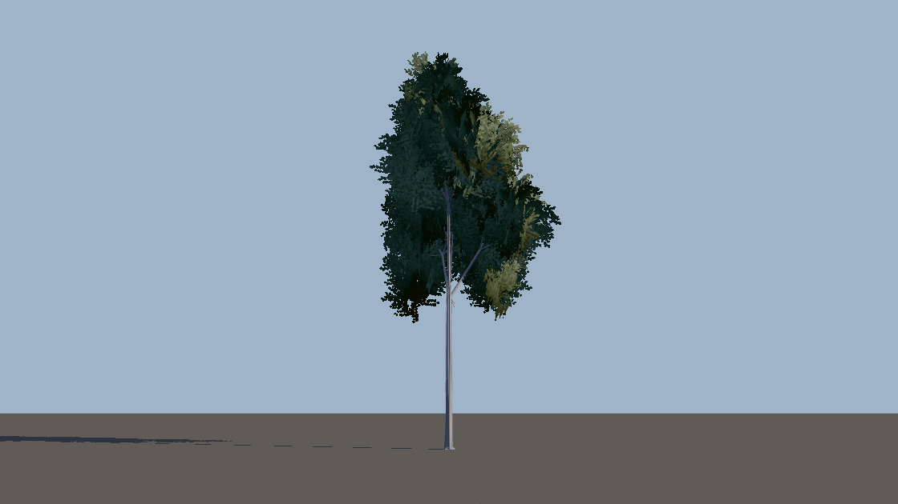 |  | — |
| (c) | 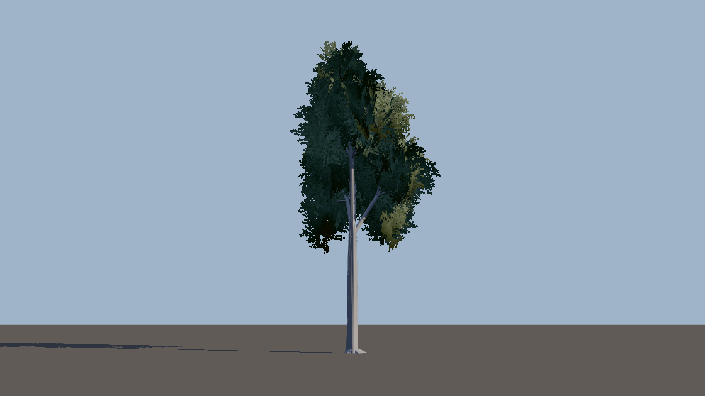 | 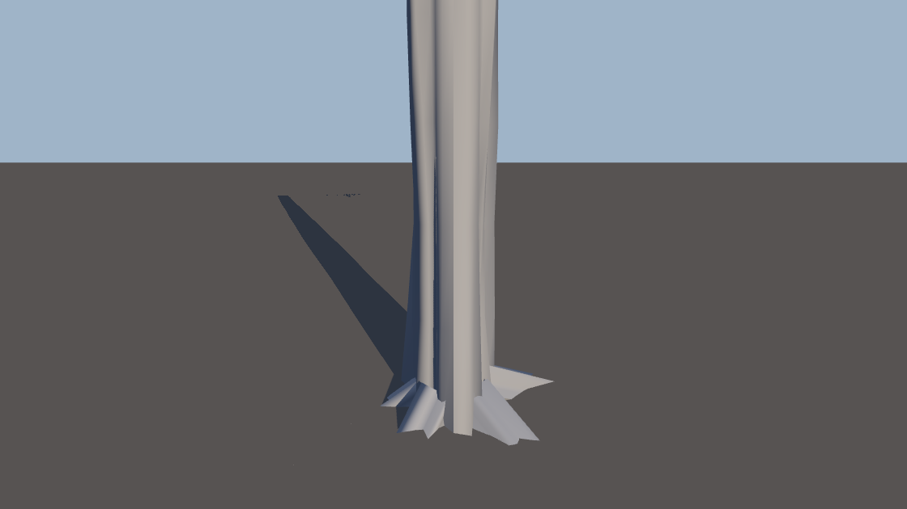 | 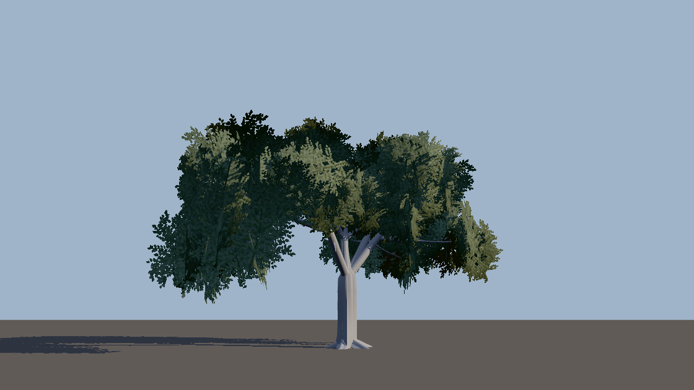 |

**Urteil Stamm.** Der Kandidat trägt bei gleichem Budget: dasselbe Skelett, dieselben 6 954 / 6 016 Dreiecke, und der Solitär
liest als Eiche statt als Schirm auf einer Stange, während 3,9-mal mehr Rinden-Dreiecke dieselbe Stange zeichnen. Er kostet
keine Dreiecke und keine messbare Bau-Zeit, aber jeder Ast wird mit dem Stamm doppelt so dick, und Karte, Schatten-Teil und der
gefühlte Baum ändern sich mit. Er reißt am Bestand (H/BHD 36,6 liegt unter dem Band 40–100: die Krone der Bestand-Eiche ist mit
9,2 m auf 17,3 m selbst zu breit) und am Solitär (H/BHD 14,4 bei 13,3 m Höhe: der Baum ist für seinen 17,6-m-Schirm zu niedrig);
den Fuß heilt er nicht — der Anlauf bleibt ein Stern-Kegel über EINEM Ring, der Schaft ein Zylinder bis zur Gabel. Der EINE
Schnitt im Kern wäre `trunkR` (`phyto-core.js:98–102`): der Radius folgt aus der gewachsenen Krone, nach dem Wuchs gesetzt (das
Skelett hängt nicht an ihm — gleiche Dreiecke bei ×2 belegen es). Dabei sterben `hd` und `FREISTAND.hd` als Eingang des Stamms
(H/BHD wird Mess-Ergebnis), die Baum-Goldens und jede Karte werden neu geprägt; die Zahl 20 ist ungeprüft und gehört vor dem
Schnitt an eine Quelle.

## 6 · Was dieser Befund NICHT trägt

- Kein Bild aus der Welt mit dem Kandidaten: Stoff, Narbe, Dach-Normale, Wind und TAA fehlen in der Bühne.
- Keine GPU-Zeit. swiftshader zeigt die Form, nicht die Kosten.
- Die Halm-Zahlen stammen aus einem Nachbau der Regel, nicht aus `emitGrass`; der Nachbau trägt keine Ähren und kein Individual-Rauschen der Vorlage.
- Raster-Rauschen naher Kronen: nicht untersucht.

## 7 · Nachfahren

```
node samen/wiese/bau.cjs <ordner>                 # Gras und Bäume über die Brücke (JSON)
node samen/wiese/bau-stamm.cjs <ordner> 2.0 2.2   # Eiche heute und mit ov.trunkMul
node samen/wiese/sieh.cjs <ordner>                # die SIEH-Bilder
node samen/wiese/spike-halm.cjs heute,mehr,trieb3 # Zahlen (halm-zahlen.json) und Bilder
node samen/wiese/spike-stamm.cjs <ordner>         # Zahlen (stamm-zahlen.json) und Bilder
node samen/wiese/mass.cjs <ordner> · ringe.cjs <datei> 3.4112 · ton.cjs <ordner>
```
