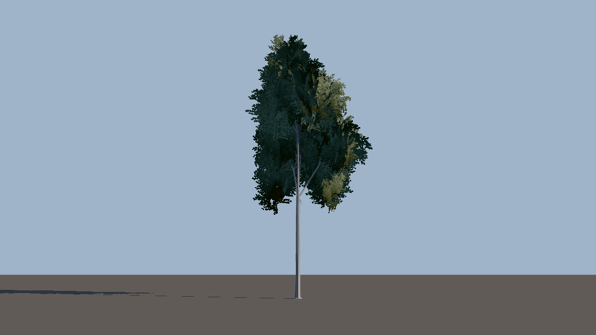
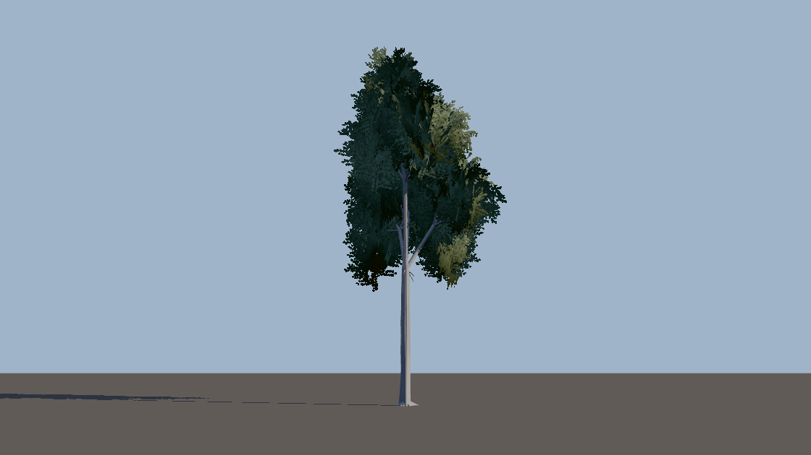
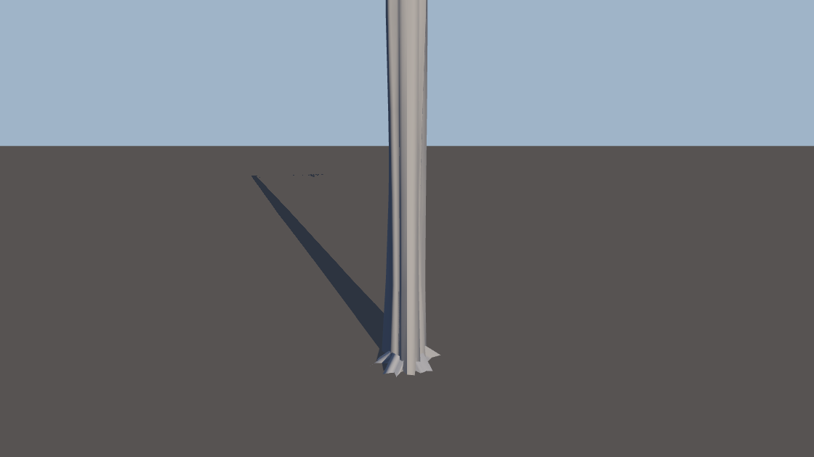
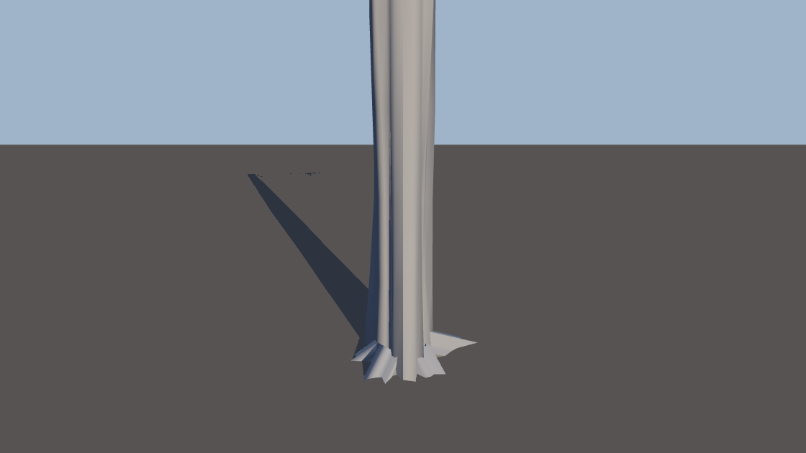
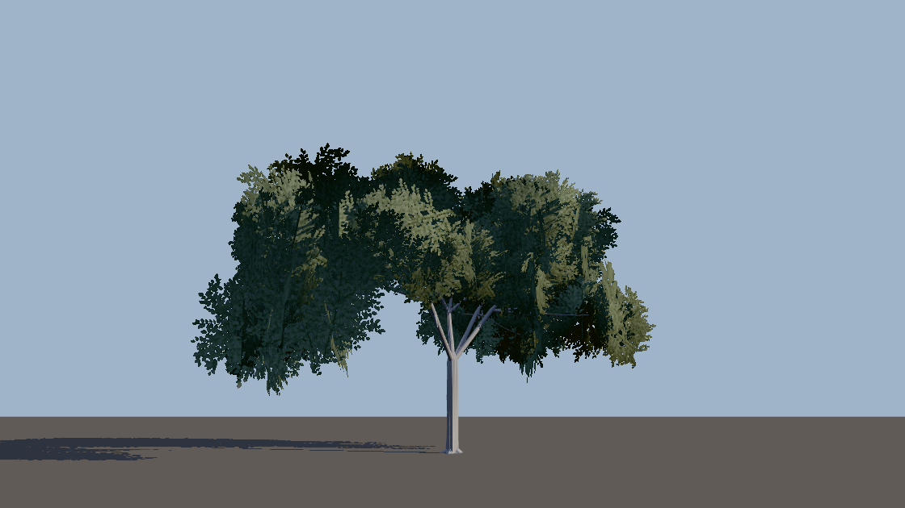
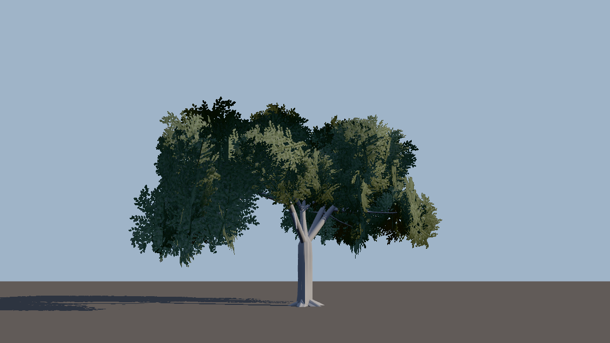
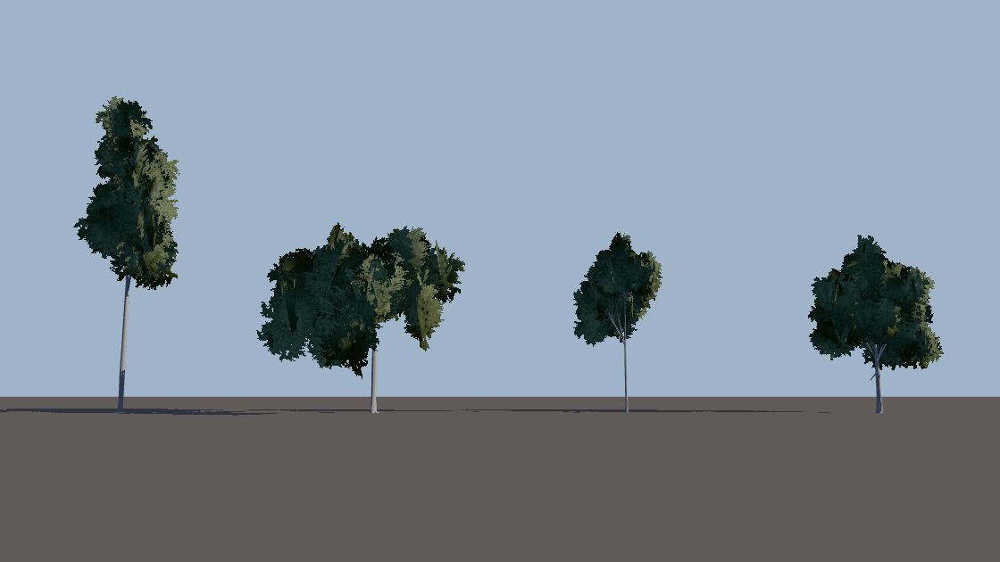
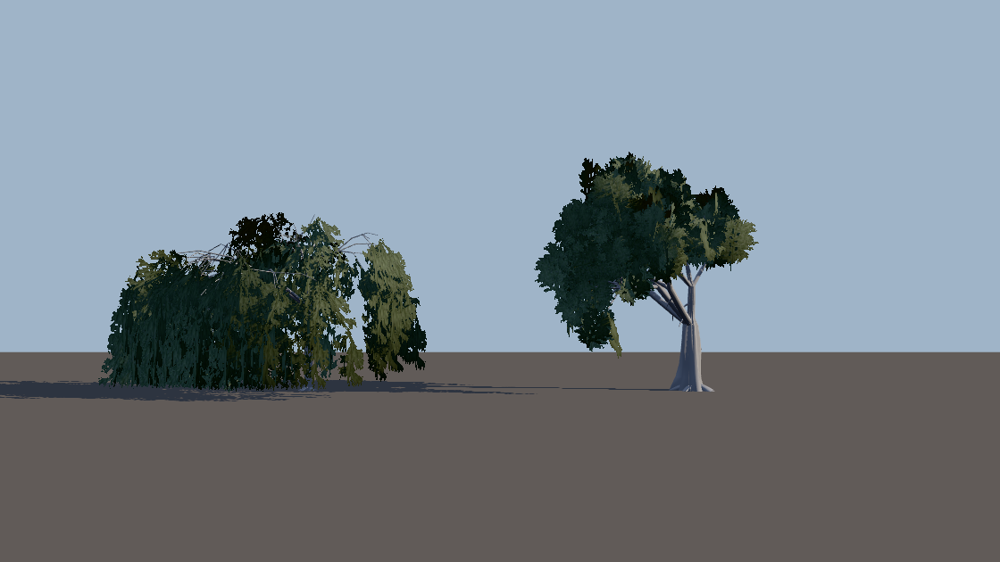
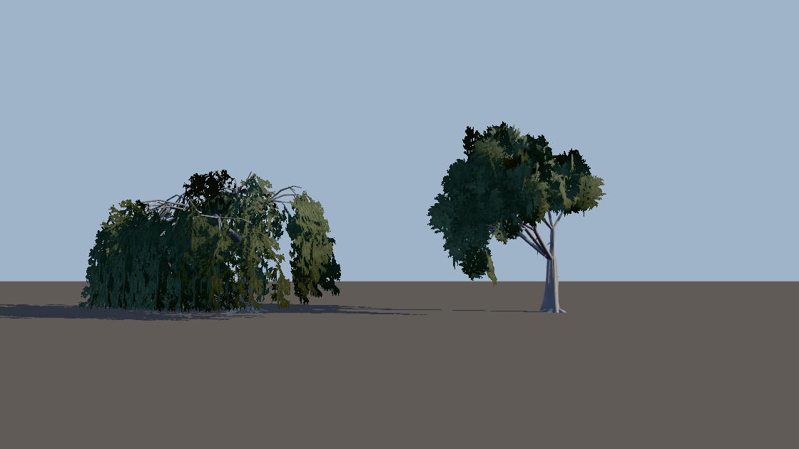

# Stufe 1 — der Stamm aus der Krone (w28-stamm-krone)

Basis `origin/main` dc872b08 · Schnitt in `phyto-core.js` (`growSkeleton`, `STAMM_KRONE`, `stammAusKrone`) · gebaut über die echte
Brücke (`scripts/lib/asset-worker-harness.cjs`), gezeichnet im selben Streiflicht wie der Befund (`spike-stamm.cjs`, swiftshader).
„Kern" heißt in den Datei-Namen des Werkzeugs `kandidat`: es ist der Bau des Kerns nach dem Schnitt, kein `ov`.

## Die Fakten-Frage: reicht da Vinci von den Spitzen?

Nein. Das Skelett ist im Stamm-Radius skalenfrei (jeder Radius ein Anteil des Stamms), die Summe von den Spitzen braucht darum EINE
absolute Zahl an der Spitze — und sie sieht die Krone nicht: Bestand und Solitär tragen fast gleich viele Trieb-Spitzen (Eiche 254
gegen 226) und fast denselben Anteil ihres Querschnitts an ihnen (ΣrΔ 0,236 gegen 0,237), bei 1,9-facher Kronen-Breite. Stamm ÷
Zweig liegt für sechs Bäume aus drei Arten bei 19,7–26,6. Fall (d) mit dem Zweig der Bestand-Eiche von heute (Median der Spitzen
6,1 mm Radius) gibt jedem Baum 0,24–0,33 m, gleich wie breit er ist.

## Die Tafel (L0, Welt-Meter)

Eiche nach dem Messgerät des Befunds (`spike-stamm.cjs`: Krone = 2 × das 90. Perzentil des Achs-Abstands der Laub-Ecken, BHD aus den
Ringen); Buche und Birke nach `mass.cjs` (Krone = 2 × das 95. Perzentil). (c) = BHD aus Krone ÷ 20 (Eiche: `ov.trunkMul` 2,0 / 2,2
des Befunds, gebaut; Buche, Birke gerechnet). (d) gerechnet am Skelett des Kerns von dc872b08.

| Baum | Fall | Dreiecke | H | BHD | H/BHD | Krone/BHD |
|---|---|---|---|---|---|---|
| Eiche Bestand (Same 1) | (a) heute | 6 954 | 17,31 | 0,238 | 72,7 | 38,6 |
| | (c) Krone ÷ 20 | 6 954 | 17,31 | 0,474 | 36,6 | 19,4 |
| | (d) Summe von den Spitzen | — | 17,31 | 0,257 | 67,3 | 35,8 |
| | **Kern** | 6 954 | 17,31 | 0,384 | 45,1 | 24,0 |
| Eiche Solitär (Same 3) | (a) heute | 6 016 | 13,31 | 0,420 | 31,7 | 41,9 |
| | (c) Krone ÷ 20 | 6 016 | 13,31 | 0,922 | 14,4 | 19,1 |
| | (d) Summe von den Spitzen | — | 13,31 | 0,261 | 51,0 | 67,4 |
| | **Kern** | 6 016 | 13,31 | 0,793 | 16,8 | 22,2 |
| Buche Bestand (Same 1) | (a) heute | 5 176 | 25,44 | 0,326 | 78,1 | 33,1 |
| | (c) | — | 25,44 | 0,539 | 47,2 | 20,0 |
| | (d) | — | 25,44 | 0,240 | 106,0 | 44,9 |
| | **Kern** | 5 176 | 25,44 | 0,417 | 61,0 | 25,8 |
| Buche Solitär (Same 3) | (a) heute | 4 702 | 16,10 | 0,373 | 43,2 | 45,9 |
| | (c) | — | 16,10 | 0,855 | 18,8 | 20,0 |
| | (d) | — | 16,10 | 0,245 | 65,6 | 69,7 |
| | **Kern** | 4 702 | 16,10 | 0,725 | 22,2 | 23,6 |
| Birke Bestand (Same 1) | (a) heute | 10 174 | 14,19 | 0,158 | 90,0 | 58,0 |
| | (c) | — | 14,19 | 0,458 | 31,0 | 20,0 |
| | (d) | — | 14,19 | 0,245 | 58,0 | 37,4 |
| | **Kern** | 10 054 | 14,19 | 0,334 | 42,5 | 27,4 |
| Birke Solitär (Same 3) | (a) heute | 8 052 | 14,68 | 0,292 | 50,4 | 36,1 |
| | (c) | — | 14,68 | 0,527 | 27,9 | 20,0 |
| | (d) | — | 14,68 | 0,325 | 45,2 | 32,4 |
| | **Kern** | 8 052 | 14,68 | 0,509 | 28,9 | 20,7 |

Bänder: H/BHD im Bestand 40–100 und der Solitär ≤ 0,6 × sein Bestand (die Station `gate:pflanzen-nah` (H), unbewegt); Krone/BHD
17–26 (Hemery, Savill & Pryor 2005, das Band wie im Kern zitiert — die Zeile je Art nicht nachgelesen: UNGEPRÜFT).
(c) reißt die Station im Bestand an Eiche (36,6) und Birke (31,0); (d) lässt jeden Solitär bei 32–70. Der Kern hält beide Bänder
an allen sechs — an der Birke im Bestand mit dem Perzentil-Gerät 27,4, mit dem Gerät der Station (sichtbare Krone, Atlas-Alpha
≥ 0,5, mittlere Breite über 8 Azimute) 19,0.

`gate:pflanzen-nah` (H), die neue Linse „Krone/BHD" (Gestalt 1, Bestand / frei): vorher Eiche 33,7 / 31,8 · Buche 23,9 / 39,8 ·
Birke 40,4 / 41,6 (5 Verletzungen) — nachher 20,9 / 21,0 · 18,7 / 19,0 · 19,0 / 19,1. H/D im Bestand vorher 73 · 74 · 88, nachher
45 · 58 · 41; Solitär vorher 36 · 38 · 49, nachher 24 · 18 · 22.

## Bilder (vorher ↔ nachher, dasselbe Streiflicht)

| | heute | Kern |
|---|---|---|
| Eiche Bestand ganz |  |  |
| Eiche Bestand Fuß |  |  |
| Eiche Solitär ganz |  |  |
| Buche Bestand · Buche Solitär · Birke Bestand · Birke Solitär |  |  |
| Karst · Weide |  |  |

## Offen

- Die Konifere trägt ihren Stamm weiter aus der Höhe (`hd`, `FREISTAND.hd`): ihr Schirm misst im Kern 19–23 m bei 22–25 m Höhe,
  und der Solitär trägt den kleineren (Fichte Same 3 Radius 9,7 m gegen 11,5 m im Bestand) — aus ihm folgte ein Stamm über
  einem Meter und ein Solitär, der schlanker ist als sein Bestand (Station (H) Solitär ≤ 0,6 ×). Erst die Krone der Konifere.
- Der Wurzelanlauf: die Ring-Teilung des Stamms entsteht im Wuchs (Strang-Enden, `schaftHub` teilt gleichmäßig, 0,60 m), das
  Anlauf-Gesetz `ffR` lebt im Rinden-Bau (`foundry-core.js`). Ringe nach seiner Krümmung brauchten einen Ring-Einschub im
  Rinden-Bau — einen zweiten Mechanismus neben der Teilung des Wuchses. Fuß/BHD bleibt 1,14.
- Kosten und das Bild im Spiel: nur die echte Karte (`[gpu-probe: …]` der Abgabe).
