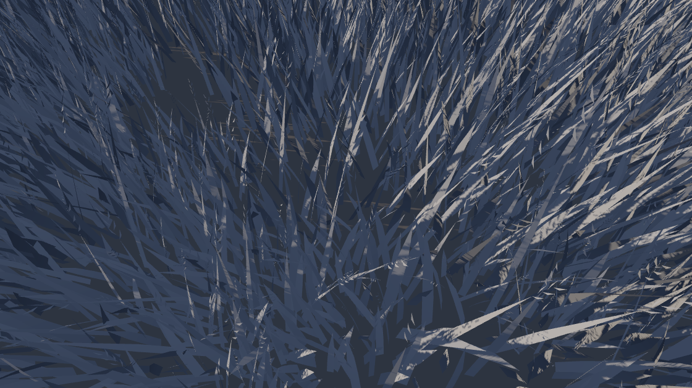
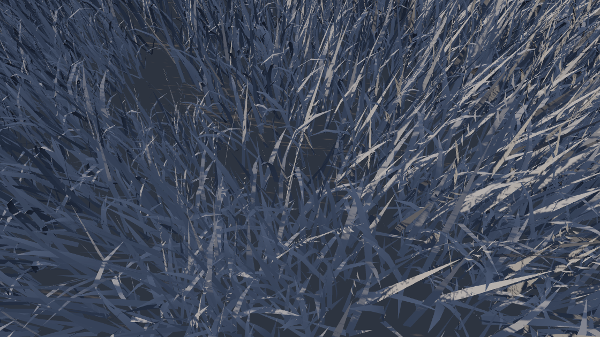
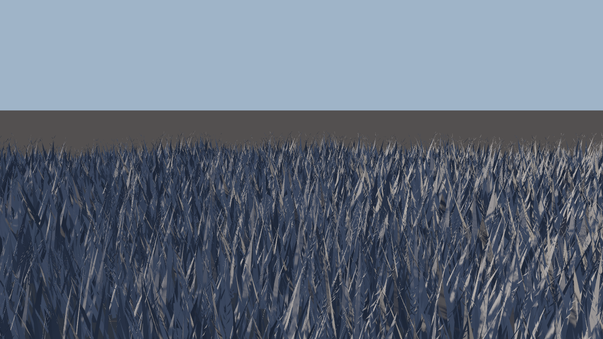
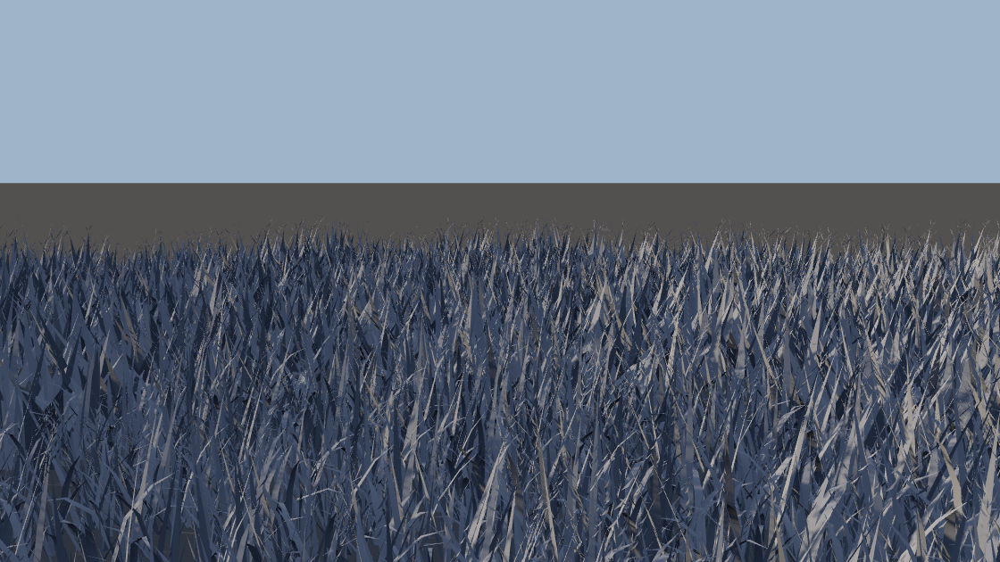
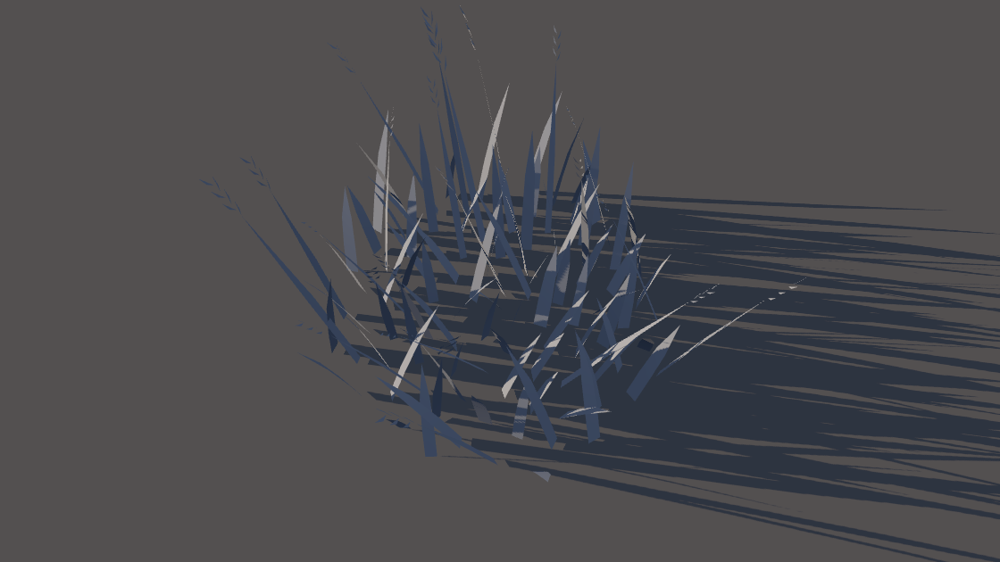
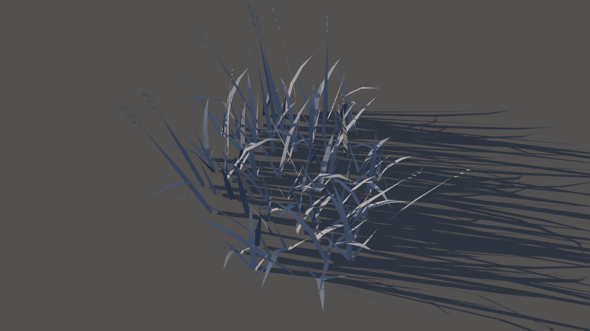
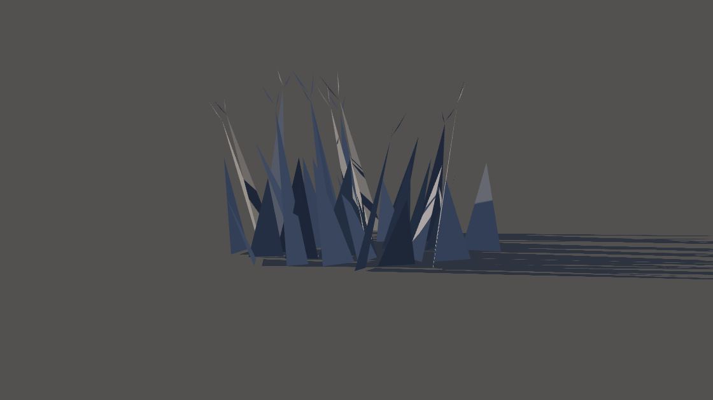
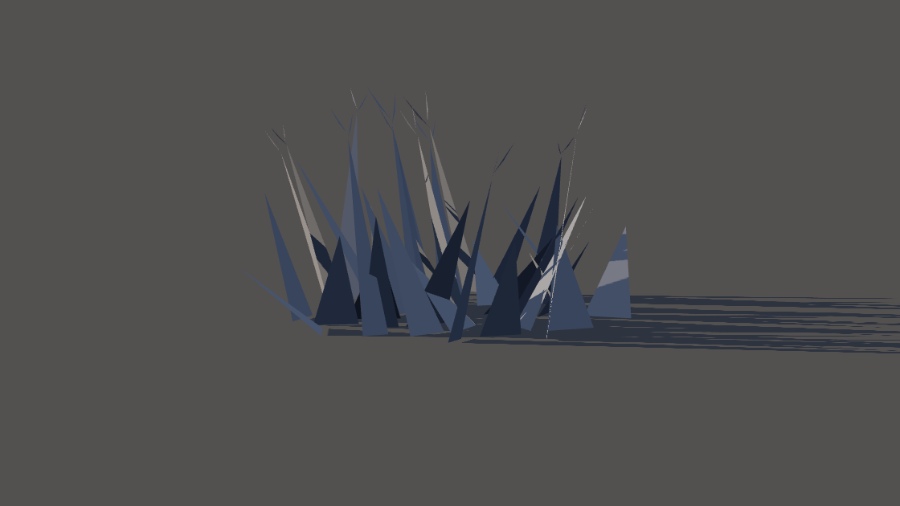

# Stufe 2 — der Halm als Trieb (w28-halm-trieb)

Basis `origin/main` 350e6b11 · Schnitt in `foundry-core.js` (`emitGrass`, `HALM_STUFEN`) und `phyto-core.js`
(`HALM_GESETZ.trieb`, `halmLinie`) · gebaut über die echte Brücke, gemessen an den Puffern des Kerns (`mass-halm.cjs`, kein
Nachbau), gezeichnet mit `sieh.cjs` im Streiflicht des Befunds (swiftshader). Das Feld: L1 bis 5 m, L2 dahinter, wie der Wirt wirft.

## Die Tafel (Vorlagen Same 1 / Same 2)

Bogen = Winkel erster ↔ letzter Abschnitt der Mittellinie, flächen-gewichtet; Knick = der größte Winkel zwischen zwei
Abschnitten eines Blatts (Median · Maximum); LAI = Blatt- und Stängel-Fläche je Raster-Zelle 0,72² m²; Narbe = uv.y am Fuß.

| Stufe | Fall | Dreiecke | Ecken | Blätter | Breite (Median) | Schlankheit | Bogen | Knick | LAI | Narbe am Fuß |
|---|---|---|---|---|---|---|---|---|---|---|
| L1 | heute | 601 / 737 | 1 091 / 1 375 | 101 / 121 | 33,1 / 36,8 mm | 10,8 / 10,3 | 5,1° / 4,9° | 4,1 · 4,4° | 1,84 / 2,48 | 1,860 / 2,509 |
| L1 | Rezept des Spikes im Kern (eine Innen-Ecke, 3 Blätter je Fuß) | 601 / 737 | 1 399 / 1 727 (+28 / +26 %) | 255 / 297 | 16,9 / 18,5 mm | 18,1 / 16,4 | 13,9° / 14,1° | 21,7 · 58,7° / 23,2 · 56,8° | 1,83 / 2,47 | — |
| L1 | **Kern** (zwei Innen-Ecken, 5 von 7 Blatt-Füßen zeichnen) | 601 / 731 | 1 267 / 1 565 (+16 / +14 %) | 189 / 219 | 22,6 / 25,6 mm | 13,2 / 12,0 | 19,3° / 19,5° | 12,5 · 39,0° / 13,9 · 37,2° | 1,83 / 2,47 | 1,854 / 2,500 |
| L2 | heute | 61 / 66 | 183 / 198 | 37 / 44 | 138,3 / 152,0 mm | 2,8 / 2,3 | 0° | — | 1,94 / 2,43 | 1,950 / 2,437 |
| L2 | **Kern** (das Bogen-Blatt auf seiner Sehne) | 61 / 66 | 183 / 198 | 37 / 44 | 121,1 / 132,5 mm | 3,4 / 2,8 | 0° | — | 1,84 / 2,31 | 1,853 / 2,322 |

Der Befund maß am Nachbau (ohne Ähren): Ecken +57 %, Breite 16,6 mm, Schlankheit 17,6, Bogen 21,7°, Knick 16–59°.

## Die vier offenen Punkte des Spikes

1. **Der Knick.** Eine Innen-Ecke trägt die ganze Drehung der Sehnen (Θ · (1 + s) ÷ 3). Das Bogen-Blatt tastet darum drei
   Abschnitte ab (Stützen 0 · 0,54 · 0,8 · 1: gleiche Drehung an beiden Ecken), und 5 von 7 Blatt-Füßen zeichnen ihren Trieb —
   dieselben Dreiecke. Knick im Median 21,7° → 12,5°, im Maximum 58,7° → 39,0°; die Breite steigt von 16,9 auf 22,6 mm.
2. **Die L2 und die Naht bei 5 m.** Dieselbe Linie, am gröbsten abgetastet: ein Dreieck auf der Sehne des Bogen-Blatts, seine
   Spitze steht, wo die der L1 steht. Breite 138–152 → 121–133 mm; das Verhältnis L2 ÷ L1 steigt von 4,1 auf 5,3. Schmaler wird
   sie nur mit mehr Dreiecken: die Budget-Zeile trüge 130, die Ratsche des Profi-Bands (± 1 %, 5 000 Dreiecke am Ort) nicht — OFFEN.
3. **Die fernen Formen.** Sie lesen die gelieferte L2: die gestreckten Büschel Fuß und Breite aus `aCenter` und `uv.x`, die Schale
   Farbe und Narbe aus `_wieseSchaleHalm`. Die eine Zahl des Wirts (`NAH_WIESE.fussNarbe` 1,86) hält die Narbe der L1 auf
   0,3 % (1,854); die neue Linse in `gate:pflanzen-nah` (Q) nennt jede Abweichung über 1 %.
4. **Die Kosten.** Dreiecke L1 601 / 737 → 601 / 731, L2 61 / 66 → 61 / 66. Ecken L1 +16 % / +14 %, L2 ±0. GPU-Zeit: nur die
   echte Karte.

## Bilder (vorher ↔ nachher)

| | heute | Kern |
|---|---|---|
| Feld auf 1 m |  |  |
| Feld auf 10 m (L1 bis 5 m, L2 dahinter) |  |  |
| Büschel L1 auf 1 m |  |  |
| Büschel L2 auf 10 m |  |  |
